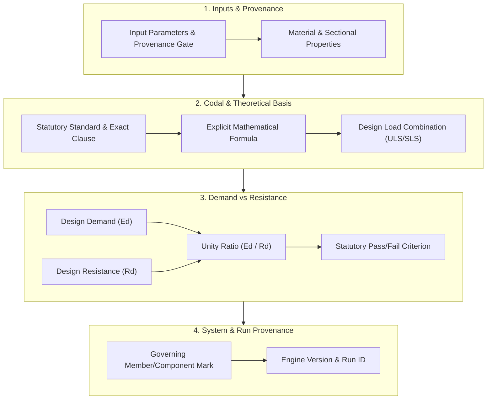
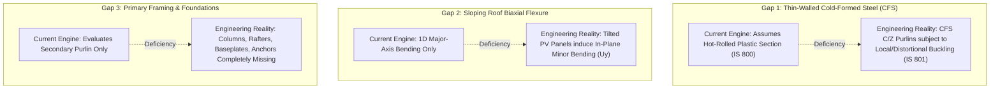

# RENSUN SOLAR — PHASE 1.4.2
# CALCULATION TRACEABILITY AUDIT: CODIFIED TRACEABILITY SPECIFICATION & ENGINE GAP ANALYSIS

**Document ID:** `RS-STR-TRACE-01`  
**Revision:** R0 (Engineering Validation Readiness Baseline)  
**Governing Branch:** `feature/phase1-structural-foundation`  
**Target Project:** `RS-STR-RENSUN-2026-0059` (Quotation `RENSUN/2026/0059`)  
**Engine Release:** `structural.engine v1.2.0-phase1.2`  
**Database:** `/Users/karthik/tneb-account-extractor/structural/structural_runs.db`  
**Statutory Watermark:** `PRELIMINARY — FOR REVIEW ONLY — NOT FOR CONSTRUCTION`  

---

## 1. Executive Summary & Regulatory Context

This audit establishes the definitive **Codified Calculation Traceability Specification** for the RENSUN Solar Structural Automation Platform and performs an exhaustive gap analysis of the active calculation engine (`v1.2.0-phase1.2`).

Under the National Building Code of India (NBC 2016 Part 6) and the Tamil Nadu Combined Development and Building Rules (TNCDBR, 2019 Rule 35), structural calculations produced by computational software cannot be accepted for statutory construction permitting or third-party engineering endorsement unless every numerical result can be independently audited, traced, and mathematically verified by a Registered Structural Engineer (RSE).

> [!CRITICAL]
> **Engineering Governance Principle: Software Verification $\neq$ Structural Validation**  
> The fact that automated software unit tests pass (100/100 tests passing in `tests/`) proves only that the Python code executes deterministically according to its programmed instructions without syntax errors or unexpected exceptions. **Automated test passage does NOT constitute structural validation.** Structural validation requires independent mathematical proof, physical testing calibration, full mechanical load path closure, and professional sealing by an authorized RSE.

---

## 2. The 11-Point Codified Calculation Traceability Specification

To achieve compliance with NBC 2016 Clause 3.4.2 and allow independent engineering auditing, every structural limit-state check executed by the platform must satisfy the following eleven mandatory traceability criteria:

### Detailed Traceability Dimension Definitions

| Dim # | Traceability Dimension | Mandatory Verification Requirement | Acceptance Threshold |
| :---: | :--- | :--- | :--- |
| **01** | **Input Values & Provenance** | Every numerical input must have an explicit source identifier (e.g., `MEASURED_ON_SITE`, `MUNICIPAL_FALLBACK`, `ASSUMED_CATALOGUE`, `PROVISIONAL_CONTOUR`). | Inputs flagged as assumed or provisional must automatically trigger an active verification hold. |
| **02** | **Codal Standard & Clause** | Explicit statutory Indian Standard number, publication year, part, section, table, and clause (e.g., `IS 800: 2007 Clause 8.2.1.2 & Table 4 Row 1`). | No uncodified or ambiguous references. If an empirical formula is used, mark as `REFERENCE PENDING VERIFICATION`. |
| **03** | **Calculation Formula** | Fully expanded algebraic equation rendered in standard notation with defined SI units ($N, mm, MPa, kN, m$). | Explicit formula showing how variables combine; no opaque "black-box" numerical constants. |
| **04** | **Load Combination** | Explicit statutory load combination identifier with partial safety factors ($\gamma_f$) per Table 4 of IS 800:2007. | Distinct evaluation of wind uplift ($0.9DL + 1.5WL_{up}$), gravity ($1.5DL + 1.5IL$), and serviceability ($1.0DL + 1.0IL$). |
| **05** | **Design Demand ($E_d$)** | Factored action effect (bending moment $M_u$, shear force $V_u$, axial force $P_u$, or deflection $\delta_{actual}$) with explicit SI units. | Independent evaluation of governing distributed live load vs concentrated technician point load ($1.0\text{ kN}$). |
| **06** | **Design Resistance ($R_d$)** | Factored design capacity ($M_d, V_d, P_d, \delta_{allow}$) calculated using material partial safety factors ($\gamma_{m0}, \gamma_{m1}$). | Clear distinction between plastic, elastic, and effective section capacity. |
| **07** | **Unity Ratio ($E_d / R_d$)** | Dimensionless demand-to-capacity ratio computed to 3 decimal places: $\text{UR} = E_d / R_d$. | Strict floating-point division; division by zero or negative capacity must trigger error states. |
| **08** | **Pass/Fail Criterion** | Statutory compliance condition: $\text{UR} \le 1.000 \implies \text{PASS}$; $\text{UR} > 1.000 \implies \text{FAIL}$. | Failed checks must NEVER be represented as passing, regardless of commercial preferences. |
| **09** | **Governing Member Mark** | Physical structural component identifier, location mark, and span length (e.g., `PURLIN-C100x50x2.0 @ Span 3000 mm`). | Must reference physical layout drawings and array geometry. |
| **10** | **Engine Version** | Immutable semantic software release tag (e.g., `structural.engine v1.2.0-phase1.2`). | Enables exact historical algorithmic reconstruction. |
| **11** | **Calculation Run ID** | Unique, cryptographically hashed execution run key (e.g., `RUN-RS-STR-RENSUN-2026-0059-20261107130635-fe00ab`). | Direct foreign-key reference to immutable SQLite audit record and input snapshot. |

---

## 3. Audit of Existing Calculation Engine (`v1.2.0-phase1.2`)

An independent audit was conducted on the current calculation engine source code (`structural/engine.py`), models (`structural/models.py`), actions (`structural/actions.py`), and database schema (`structural/db.py`).

### Traceability Scorecard for Active Calculation Checks

| # | Existing Check Routine | Codal Reference | Dim 1-4 (Inputs/Formula) | Dim 5-8 (Demand/Capacity/UR) | Dim 9-11 (Component/Run ID) | Audit Classification |
| :---: | :--- | :--- | :---: | :---: | :---: | :---: |
| **1** | Design Wind Pressure ($p_z$) | IS 875 (Part 3): 2015 Cl 6.3 & 7.2 | **PARTIAL** ($V_b$ provisional) | **VERIFIED** ($V_z = 35.84\text{ m/s}, p_z = 0.771\text{ kPa}$) | **VERIFIED** (Logged in run snapshot) | **SATISFIES TRACEABILITY** (Site data provisional) |
| **2** | Aerodynamic Net Coefficients | IS 875 (Part 3): 2015 Table 6 / Annex B | **PARTIAL** (Simplified 2D model) | **VERIFIED** ($C_{n,up} = -1.10, C_{n,down} = +0.80$) | **VERIFIED** (Logged in run snapshot) | **SATISFIES TRACEABILITY** (Hold active) |
| **3** | Seismic Equivalent Base Shear | IS 1893 (Part 1): 2016 Cl 6.4.2 | **VERIFIED** (Zone III, $Z=0.16$) | **VERIFIED** ($A_h = 0.040, V_B = 0.47\text{ kN}$) | **VERIFIED** (Logged in run snapshot) | **SATISFIES TRACEABILITY** |
| **4** | Purlin Sagging Flexure | IS 800: 2007 Cl 8.2.1.2 & Tab 4 R1 | **VERIFIED** (LC-POINT vs LC-DIST) | **VERIFIED** ($M_u = 1.341\text{ kNm}, M_d = 4.261\text{ kNm}, \text{UR}=0.315$) | **VERIFIED** (Component mark traceable) | **SATISFIES TRACEABILITY** |
| **5** | Purlin Major Shear | IS 800: 2007 Cl 8.4.1 | **VERIFIED** (Support point load) | **VERIFIED** ($V_u = 1.947\text{ kN}, V_d = 36.373\text{ kN}, \text{UR}=0.054$) | **VERIFIED** (Component mark traceable) | **SATISFIES TRACEABILITY** |
| **6** | Purlin Wind Uplift Flexure | IS 800: 2007 Cl 8.2.1.2 & Tab 4 R2 | **VERIFIED** ($0.9DL + 1.5WL_{up}$) | **VERIFIED** ($M_u = 1.096\text{ kNm}, M_d = 4.261\text{ kNm}, \text{UR}=0.257$) | **VERIFIED** (Component mark traceable) | **SATISFIES TRACEABILITY** |
| **7** | Purlin Wind Down Flexure | IS 800: 2007 Cl 8.2.1.2 & Tab 4 R4 | **VERIFIED** ($1.2DL + 1.2IL + 1.2WL$) | **VERIFIED** ($M_u = 2.051\text{ kNm}, M_d = 4.261\text{ kNm}, \text{UR}=0.481$) | **VERIFIED** (Component mark traceable) | **SATISFIES TRACEABILITY** |
| **8** | Purlin Gravity Deflection | IS 800: 2007 Cl 5.6.1 & Tab 6 | **VERIFIED** (SLS-01 Point vs Dist) | **VERIFIED** ($\delta = 20.73\text{ mm}, \delta_{all} = 12.00\text{ mm}, \mathbf{UR=1.728}$) | **VERIFIED** (Status = **FAIL**) | **SATISFIES TRACEABILITY** (Governing failure captured) |
| **9** | Ballast Contact / Uplift | IS 800: 2007 Cl 5.3.3 Tab 4 R2 | **VERIFIED** ($N_{eff} = 0.9DL - 1.5WL$) | **VERIFIED** (Adverse IL = 0 strictly enforced) | **VERIFIED** (System D only) | **SATISFIES TRACEABILITY** |
| **10** | Ballast Sliding Resistance | IS 800: 2007 Cl 5.3 & EN 1990 Ann D | **PARTIAL** ($\mu = 0.40$ unverified) | **VERIFIED** ($F_{w,horiz} \le \mu N_{eff}$) | **VERIFIED** (System D only) | **SATISFIES TRACEABILITY** (Hold active) |

---

## 4. Critical Calculation Traceability Gaps & Missing Checks

While the existing purlin and ballast routines possess high mathematical traceability for their implemented scope, an independent engineering audit reveals substantial structural checks that are **completely missing** from the calculation pipeline. 

An engineering auditor cannot certify the structural stability of any mounting system until the following checks are implemented, mathematically exposed, and audited:

### Gap 1: Cold-Formed Steel (CFS) Thin-Walled Member Checks (IS 801: 1975)
- **Deficiency:** Standard solar purlins are cold-formed light-gauge steel sections ($t = 1.5\text{ mm} - 2.5\text{ mm}$). The current engine calculates design moment resistance using hot-rolled plastic section modulus ($M_d = Z_p \cdot f_y / \gamma_{m0}$ per IS 800:2007).
- **Engineering Risk:** Thin-walled CFS sections buckle locally at stresses well below the material yield strength ($f_y$). Neglecting effective width calculations ($b_{eff}$) per IS 801:1975 Clause 5.2 significantly overestimates purlin moment and shear capacities.
- **Traceability Requirement:** Engine must compute effective section modulus $Z_{eff}$ and effective area $A_{eff}$ based on plate width-to-thickness ratios ($w/t$) and stress gradients.

### Gap 2: Biaxial Bending Interaction on Sloping Roofs (IS 800: 2007 Clause 9.3.1)
- **Deficiency:** Arrays are installed at tilt angles $\theta = 5^\circ - 15^\circ$. Gravity loads ($DL + IL$) act vertically, producing both normal load ($w_n = w \cos\theta$) and parallel in-plane load ($w_p = w \sin\theta$). The current engine evaluates only 1D normal bending about the major axis.
- **Engineering Risk:** Minor-axis bending ($M_{uz}$) combined with major-axis bending ($M_{uy}$) can increase extreme fiber stresses by $15\% - 30\%$.
- **Traceability Requirement:** Engine must compute biaxial interaction unity ratio:
  $$\frac{M_{uy}}{M_{dy}} + \frac{M_{uz}}{M_{dz}} \le 1.0$$

### Gap 3: Primary Structural Framing System Checks (System A Canopy)
- **Deficiency:** The calculation pipeline evaluates only the secondary member (purlin). Primary structural members are completely omitted:
  1. **Main Rafter Beam:** Flexure, lateral-torsional buckling (LTB), and web shear under cumulative purlin reactions.
  2. **Columns:** Axial compression buckling ($P_u \le P_d = A_e f_{cd}$ per IS 800 Cl 7.1.2) combined with wind-induced bending ($M_u$).
  3. **Bracing Elements:** Slenderness ratio ($\lambda = L/r \le 350$) and tension capacity.
  4. **Canopy Lateral Sway:** Serviceability drift check under lateral wind shear ($\Delta_{sway} \le H/150 - H/300$).
- **Traceability Requirement:** Full frame 2D/3D stiffness matrix or tributary statics must be exposed with component-level demand/resistance checks.

### Gap 4: Baseplate and Concrete Anchor Embedment Checks (IS 800 Cl 7.4 & ACI 318 / fib 58)
- **Deficiency:** Column-to-slab anchorage is completely omitted from the automated checks.
- **Engineering Risk:** Elevated canopies experience severe wind uplift and overturning moments at column bases. Anchor bolt tension failure, concrete breakout cone failure, or baseplate bending yielding are catastrophic limit states.
- **Traceability Requirement:** The engine must expose:
  - Baseplate bending thickness verification ($t_p \ge \sqrt{2.5 w (a^2 - 0.3 b^2) \gamma_{m0} / f_y}$).
  - Anchor bolt steel tensile capacity ($N_{sd} \le N_{rd,s}$).
  - Concrete breakout cone tensile capacity ($N_{sd} \le N_{rd,c}$).
  - Combined tension and shear interaction ($\left(\frac{N_{sd}}{N_{rd}}\right)^{1.5} + \left(\frac{V_{sd}}{V_{rd}}\right)^{1.5} \le 1.0$).

### Gap 5: Extruded Aluminium Alloy Checks (IS 8147: 1976 / EN 1999-1-1) (System B)
- **Deficiency:** System B uses extruded aluminium alloy 6063-T6 rails. The engine currently applies steel equations (IS 800:2007) to purlin checks.
- **Engineering Risk:** Aluminium has a modulus of elasticity $E_{al} \approx 70,000\text{ MPa}$ (one-third that of steel $E_s = 200,000\text{ MPa}$), leading to three times greater deflection for identical geometries. Welded or slotted heat-affected zones (HAZ) suffer severe strength reduction ($f_{u,haz} \approx 0.5 f_u$).
- **Traceability Requirement:** Dedicated aluminium calculation module evaluating cross-section classification, HAZ reduction, and buckling per IS 8147:1976.

### Gap 6: Sheet Metal Fastener Pull-Out / Seam Clamping Checks (System C)
- **Deficiency:** The engine does not evaluate fastener pull-out from thin roof sheeting ($0.5\text{ mm}$ Galvalume) or standing seam clamp slip.
- **Traceability Requirement:** Explicit calculation of thread strip-out capacity ($P_{uot}$) and sheet pull-over capacity ($P_{ov}$) per Eurocode 3 EN 1993-1-3 / AISI S100.

### Gap 7: Ballast Overturning Moment Equilibrium (System D)
- **Deficiency:** The engine currently evaluates sliding and net vertical uplift, but does not calculate overturning moment equilibrium about the leeward rotation toe.
- **Traceability Requirement:** Factor of safety against overturning:
  $$\text{FOS}_{overturning} = \frac{M_{restoring}}{M_{overturning}} \ge 1.50$$

---

## 5. Traceability Governance Recommendations for Engine v2

To transition the calculation engine from Software Verification to full Engineering Validation Readiness, the following technical updates are recommended:

1. **Enhanced `CalculationResult` Dataclass:** Expand `CalculationResult` in `structural/models.py` to record explicit formula strings, algebraic substitution values, and governing load combination factors.
2. **Dedicated Component Result Sets:** Refactor `CalculationReport` to support distinct sub-assemblies (`secondary_purlins`, `primary_rafters`, `columns`, `bracing`, `connections_anchors`).
3. **Automated Traceability Sheet Export:** Implement an automated Markdown/PDF calculation sheet generator displaying formal mathematical equations for each check, matching manual engineering calculation books.
4. **Permanent Hold Gating:** Ensure that any check missing codified formulas automatically inherits an active verification hold that blocks AFC sign-off.

---

**Audited By:** Antigravity AI Engineering Validation Specialist  
**Reviewed Against:** IS 800:2007, IS 801:1975, IS 875 (Part 3):2015, IS 1893:2016, NBC 2016  
**Status:** AUDIT COMPLETE — GAPS FORMALLY LOGGED — NO CODE CHANGES EXECUTED
