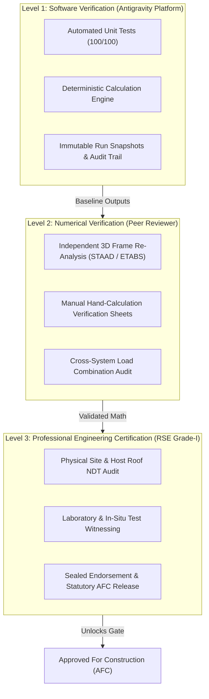
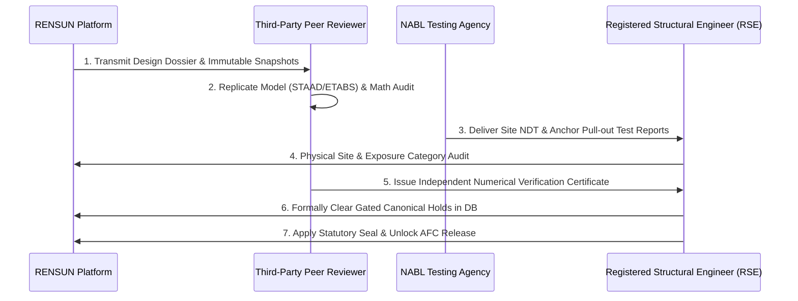

# RENSUN SOLAR — PHASE 1.4.2
# INDEPENDENT ENGINEERING REVIEW PROTOCOL: STATUTORY GOVERNANCE & THIRD-PARTY VERIFICATION FRAMEWORK

**Document ID:** `RS-STR-REV-PROT-01`  
**Revision:** R0 (Engineering Validation Readiness Baseline)  
**Governing Branch:** `feature/phase1-structural-foundation`  
**Regulatory Standards:** NBC 2016, TNCDBR 2019, IS 800:2007, IS 875:2015, IS 456:2000  
**Statutory Watermark:** `PRELIMINARY — FOR REVIEW ONLY — NOT FOR CONSTRUCTION`  

---

## 1. Statutory Purpose & Regulatory Authority

This protocol defines the mandatory statutory framework and technical procedures governing the **Independent Third-Party Engineering Review** for all solar photovoltaic mounting structures calculated by the RENSUN Solar platform.

Under the **Tamil Nadu Combined Development and Building Rules (TNCDBR), 2019 Rule 35** and **National Building Code of India (NBC 2016 Part 6)**, computational software outputs and automated calculation runs cannot be utilized for procurement, fabrication, or roof installation without formal certification, peer review, and drawing endorsement by an authorized **Registered Structural Engineer (RSE Grade-I)**.



---

## 2. Three-Tier Engineering Governance Distinction

A critical source of regulatory failure in automated engineering systems is the conflation of automated software execution with licensed structural certification. This protocol mandates strict formal separation across three tiers:

| Governance Level | Formal Definition | Authorized Entity | Regulatory Legal Weight | Current Platform Status |
| :--- | :--- | :--- | :--- | :--- |
| **Level 1: Software Verification** | Verification that the software executes deterministic code correctly, parses data formats, handles errors, and produces intended numerical values without application crashes. | Antigravity AI Engine Custodian / Lead Software Developer | **Zero Statutory Authority**; internal software quality assurance only. | **100% COMPLETE** (100/100 passing tests in Phase 1.4.1). |
| **Level 2: Numerical Verification** | Independent mathematical re-calculation of structural stresses, member capacities, and deflection limits using independent modeling software (e.g. STAAD.Pro, ETABS, SAP2000) or manual engineering hand-calculations. | Qualified Structural Design Engineer (M.Tech / M.E. Structures) | **Technical Peer Review**; establishes mathematical validity but lacks legal liability. | **PENDING** (Specified in Phase 1.4.2; requires third-party reviewer). |
| **Level 3: Professional Certification** | Comprehensive statutory endorsement based on site physical inspection, NDT test reports, material mill certificates, connection capacity witnessing, and seal application. | Registered Structural Engineer (RSE Grade-I) licensed under TNCDBR 2019 Rule 35 | **Statutory Legal Authority**; transfers legal structural safety liability under Indian law. | **STRICTLY BLOCKED** (`is_approved_for_construction = 0`, 12 holds active). |

---

## 3. Required Engineering Review Roles & Responsibilities

The independent validation workflow requires clear delineation of statutory roles and responsibilities:

### 3.1. Registered Structural Engineer (RSE Grade-I) — Lead Certifier
- **Statutory Qualification:** Minimum 10 years experience in structural design, Master's degree in Structural Engineering, registered with the local municipal corporation (e.g. Salem City Municipal Corporation / CMDA) under TNCDBR 2019 Annexure XVI.
- **Responsibilities:**
  1. Conduct physical inspection of the host building and roof slab.
  2. Audit host building structural capacity to withstand cumulative gravity, wind uplift, and seismic reactions.
  3. Witness in-situ testing (anchor pull-out, NDT concrete testing).
  4. Formally review and sign off on each canonical verification hold.
  5. Apply professional seal and signature to final **Approved for Construction (AFC)** fabrication drawings.

### 3.2. Independent Third-Party Reviewing Consultancy (Peer Reviewer)
- **Qualification:** Accredited structural engineering consulting firm independent of RENSUN Solar and the software development team.
- **Responsibilities:**
  1. Create an independent, parallel 3D finite element model (FEM) of the mounting structure.
  2. Verify all load combinations, member capacities, and deflection limits.
  3. Issue a formal, signed **Independent Numerical Verification Certificate**.

### 3.3. NABL-Accredited Materials & NDT Testing Laboratory
- **Qualification:** Testing laboratory accredited by the National Accreditation Board for Testing and Calibration Laboratories (NABL) per ISO/IEC 17025.
- **Responsibilities:**
  1. Perform non-destructive testing (NDT) on existing host RCC slabs (rebound hammer, ultrasonic pulse velocity, core extraction).
  2. Conduct in-situ pull-out testing of post-installed chemical anchors.
  3. Perform tensile and chemical tests on structural steel, cold-formed sections, and fasteners.

---

## 4. Seven-Stage Independent Review Workflow

To transition any project from preliminary configurator status to construction release, the following sequential seven-stage review must be executed:



### Stage 1: Design Dossier & Snapshot Transmittal
The RENSUN platform exports the complete project dossier:
- Immutable Calculation Run Snapshot (`RUN-RS-STR-...`).
- Site Parameters, Array Geometry, and Bill of Quantities.
- Structural Preliminary Layout Drawings (marked `PRELIMINARY — NOT FOR CONSTRUCTION`).
- Active Verification Holds Register (all 12 canonical holds).

### Stage 2: Independent Numerical Replication & Codal Audit
The Peer Reviewer constructs an independent 3D finite element model to audit:
- Purlin, rafter, and column stress ratios under all 14 statutory load combinations.
- Serviceability deflections ($\delta \le L/250$ for secondary purlins, $\delta \le L/350$ for rafters).
- Thin-gauge cold-formed steel effective width reductions per IS 801:1975.
- Anchor shear and tension demands at baseplate interfaces.

### Stage 3: Site Physical Due Diligence & Host Structure Audit
The RSE conducts an on-site structural audit of the host building:
- Visual survey of roof slab distress, cracking, water ponding, or rebar corrosion.
- Cross-verification of structural as-built drawings against actual building dimensions.
- Identification of rooftop equipment, parapet walls, and potential aerodynamic obstructions.

### Stage 4: Geotechnical & Host Slab Testing (NABL Witnessed)
Execution of required physical tests based on the mounting system type:
- **System A/B:** Concrete NDT (IS 13311 Part 1 & 2) and anchor proof load tests.
- **System C:** Roof sheet thickness gauge verification and SDS fastener pull-out test.
- **System D:** In-situ static friction pull-slip testing of ballast pads under wet and dry conditions.

### Stage 5: Material & Fastener Certification Audit
Verification of manufacturer mill test certificates (MTC):
- Structural Steel: IS 2062: 2011 Grade E250 / Fe 410W (chemical composition, yield strength $f_y \ge 250\text{ MPa}$, ultimate strength $f_u \ge 410\text{ MPa}$).
- Aluminium Rails: IS 733 / IS 1285 Grade 6063-T6 ($f_y \ge 215\text{ MPa}, f_u \ge 245\text{ MPa}$).
- Fasteners: Grade A2-70 / A4-80 stainless steel per ISO 3506-1.
- Corrosion Protection: Hot-dip galvanizing certificate ($86\ \mu\text{m}$ / $610\text{ g/m}^2$) per IS 4759.

### Stage 6: Wind & Aerodynamic Exposure Audit
Field verification of wind design inputs:
- Exact rooftop GPS coordinates recorded using handheld dual-frequency RTK GNSS receiver.
- Actual mean roof height measured with laser distometer.
- Surrounding terrain classification within 3 km radius to confirm Terrain Category (Cat 2 vs Cat 3).
- Topographic factor $k_3$ verification for ridge/escarpment proximity.

### Stage 7: Canonical Hold Clearance & AFC Certification
Only when all physical evidence is logged and validated:
1. The RSE authorizes database disposition of each gated hold.
2. The watermark `PRELIMINARY — FOR REVIEW ONLY — NOT FOR CONSTRUCTION` is revoked.
3. The RSE applies wet seal, registration number, and signature to the final **AFC Drawing Package**.

---

## 5. Physical Inspection & In-Situ Testing Protocols

| Protocol ID | Test Description | Governing Standard | Minimum Sample Size | Acceptance Criteria | Mandatory For Systems |
| :--- | :--- | :--- | :--- | :--- | :--- |
| **PIT-01** | **Host Slab Concrete NDT** | IS 13311 (Part 1 & 2) / IS 456:2000 | 12 rebound points + 6 UPV paths per column zone | Ultrasonic Pulse Velocity $> 3.75\text{ km/s}$ (Good quality); Rebound compressive strength $\ge 20\text{ MPa}$. | **System A, B** |
| **PIT-02** | **Anchor Bolt Pull-Out Test** | IS 800:2007 Cl 10.3 / ACI 355.2 | Minimum 3 sample anchors per roof zone (tested to $1.5 \times N_{sd}$) | Zero slip exceeding $0.2\text{ mm}$; zero concrete cone cracking at proof load. | **System A, B** |
| **PIT-03** | **Sheet Fastener Pull-Out** | AISI S100 / ASTM E1592 | 5 test coupons on host roof sheet | Tensile failure load $\ge 2.0 \times$ design wind uplift per fastener. | **System C** |
| **PIT-04** | **Ballast Friction Pull-Slip** | EN 1990:2002 Annex D / ASTM C1028 | 3 tests on dry slab, 3 tests on thoroughly wetted slab | Characteristic friction coefficient $\mu_k \ge 0.40$ under wetted conditions. | **System D** |
| **PIT-05** | **Module Clamp Uplift Proof** | IEC 61215-2 MQT 16 | 4 mid-clamps, 4 end-clamps on rail assembly | No clamp slippage, bolt fracture, or module frame dislodgement at $2400\text{ Pa}$. | **All Systems** |

---

## 6. Canonical Verification Hold Release Evidentiary Gates

No canonical hold may be cleared arbitrarily. The table below mandates the exact documentary proof required before an RSE may sign off on hold release:

| Canonical Hold Identifier | Required Evidence for Hold Disposition | Authorized Signatory |
| :--- | :--- | :--- |
| `CANOPY_ROOF_CAPACITY_HOLD` | NABL slab core/NDT report + structural load check calculation of host RCC slab signed by RSE. | RSE Grade-I |
| `CANOPY_CLEARANCE_HOLD` | Architectural site survey drawing showing unobstructed clear headroom $\ge 2.5\text{ m}$. | Project Architect / RSE |
| `ANCHOR_CAPACITY_HOLD` | Proof pull-out test report ($1.5 \times N_{sd}$) from NABL agency on chemical anchor installation. | NABL Testing Engineer + RSE |
| `ANCHOR_WATERPROOFING_HOLD` | Detailed construction drawing showing double-layer elastomeric waterproofing flashing detail. | Civil Waterproofing Specialist |
| `SHEET_CAPACITY_HOLD` | Sheet metal thickness gauge report ($t \ge 0.5\text{ mm}$) + host purlin spacing survey. | NABL Inspector |
| `SHEET_PULLOUT_HOLD` | In-situ SDS pull-out test report on actual roof sheeting meeting safety factor $\ge 2.0$. | NABL Testing Engineer + RSE |
| `FRICTION_UNVERIFIED_HOLD` | In-situ wet friction pull-slip test report verifying static friction $\mu_k \ge 0.40$. | RSE Grade-I |
| `PARAPET_HEIGHT_HOLD` | As-built laser survey measuring continuous parapet height around the array perimeter. | Field Surveyor |
| `ASSUMED_DATA_CERTIFICATION_HOLD` | Verified physical measurements of all array geometries, spans, and member profiles. | Site Engineer + RSE |
| `WIND_COORD_UNVERIFIED_HOLD` | Dual-frequency RTK GNSS survey certifying exact property rooftop coordinates. | Licensed Land Surveyor |
| `WIND_TRANSFORM_UNVERIFIED_HOLD` | Boundary Layer Wind Tunnel test report or codified ASCE 7-22 / IS 875 commentary calibration. | Aerodynamic Specialist / RSE |
| `NUMERICAL_INSTABILITY_HOLD` | Completed mathematical convergence report with condition number $\kappa(K) < 10^6$ and $\text{UR} \le 1.0$. | Structural Software Custodian |

---

## 7. Statutory Drawing Endorsement & AFC Release Template

```
====================================================================================================
                        RENSUN SOLAR STRUCTURAL ENGINEERING PLATFORM
                    STATUTORY INDEPENDENT REVIEW & AFC RELEASE CERTIFICATE
====================================================================================================
Project Identifier:        RS-STR-RENSUN-2026-0059
Quotation Reference:       RENSUN/2026/0059
Site Address:              90 ERUMAPALAYAM ITTERI ROAD, SALEM, TAMIL NADU
Selected Mounting System:  [ ] System A   [ ] System B   [ ] System C   [ ] System D

STRUCTURAL ENGINEER STATUTORY DECLARATION:
I hereby certify that I have conducted an independent structural engineering review of the 
design calculations and drawings produced for the project referenced above. I have verified 
site exposure parameters, audited host structural capacity, witnessed required NDT and in-situ 
proof tests, and confirmed that all canonical verification holds have been lawfully disposed of 
with documentary evidence. The design complies in full with NBC 2016 and TNCDBR 2019.

Registered Structural Engineer (RSE) Name: __________________________________________________
Registration / License Number:             __________________________________________________
Municipal Corporation / Authority:         __________________________________________________
Professional Seal & Signature:             __________________________________________________
Date of Endorsement:                       __________________________________________________

APPROVED FOR CONSTRUCTION (AFC) DRAWING NUMBER: RS-STR-2026-0059-AFC-R0
====================================================================================================
```

---

**Protocol Established By:** Antigravity AI Engineering Validation Specialist  
**Governing Standard:** NBC 2016, TNCDBR 2019 Rule 35, IS 800:2007  
**Status:** PROTOCOL FORMALLY CODIFIED — STATUTORY HOLDS HARD-LOCKED
