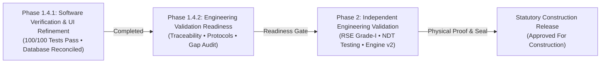

# RENSUN SOLAR — PHASE 1.4.2
# STRUCTURAL ENGINEERING VALIDATION READINESS MASTER REPORT

**Document ID:** `RS-STR-EVR-REP-01`  
**Revision:** R0 (Owner Review Baseline)  
**Date:** 2026-11-07  
**Governing Branch:** `feature/phase1-structural-foundation`  
**Target Project:** `RS-STR-RENSUN-2026-0059` (Quotation `RENSUN/2026/0059`)  
**Site Address:** `90 ERUMAPALAYAM ITTERI ROAD, SALEM, TAMIL NADU`  
**Platform Version:** `structural.engine v1.2.0-phase1.2`  
**Statutory Watermark:** `PRELIMINARY — FOR REVIEW ONLY — NOT FOR CONSTRUCTION`  

---

## 1. Executive Summary & Readiness Assessment

This report marks the formal completion of **Phase 1.4.2: Structural Engineering Validation Readiness** for the RENSUN Solar Structural Automation Platform.

Following the successful owner acceptance of Phase 1.4.1 software verification and UI refinement, Phase 1.4.2 was commissioned to prepare the calculation platform for a controlled, independently reviewable engineering validation process.



### Master Engineering Readiness Declaration
The RENSUN Solar structural calculation platform is classified as having achieved:
$$\mathbf{CONDITIONAL\ PRE-VALIDATION\ READINESS}$$

- **Software Layer:** Fully verified, deterministic, and regression-tested (100/100 tests passing).
- **Audit & Governance Layer:** Fully locked with immutable snapshots, strict hold registers, and statutory watermarks.
- **Physical Engineering Layer:** Pre-validation only. Commercial installation, fabrication, and construction release (AFC) remain **strictly hard-locked** pending physical site surveys, NABL laboratory testing, calculation engine expansion (CFS/Framing/Anchors), and wet-seal certification by a Licensed Registered Structural Engineer (RSE Grade-I).

---

## 2. Deliverables Suite Summary

In compliance with the Phase 1.4.2 task mandate, a comprehensive six-document engineering governance suite has been authored and placed under version control:

| # | Document File | Document ID | Purpose & Key Engineering Scope |
| :---: | :--- | :--- | :--- |
| **1** | [`STRUCTURAL_VALIDATION_MATRIX.md`](file:///Users/karthik/tneb-account-extractor/STRUCTURAL_VALIDATION_MATRIX.md) | `RS-STR-VAL-MAT-01` | Consolidated cross-system comparative matrix across Systems A, B, C, D covering loading, standards, ULS/SLS checks, physical tests, and canonical hold mappings. |
| **2** | [`FOUR_SYSTEM_VALIDATION_REQUIREMENTS.md`](file:///Users/karthik/tneb-account-extractor/FOUR_SYSTEM_VALIDATION_REQUIREMENTS.md) | `RS-STR-4SYS-REQ-01` | Exhaustive engineering validation deep-dive across all four canonical mounting systems across thirteen statutory dimensions. |
| **3** | [`SITE_DATA_EVIDENCE_REQUIREMENTS.md`](file:///Users/karthik/tneb-account-extractor/SITE_DATA_EVIDENCE_REQUIREMENTS.md) | `RS-STR-SITE-EV-01` | Site data governance, spatial analysis of Salem municipal centroid ($11.6643^\circ\text{N}, 78.1460^\circ\text{E}$) vs Erumapalayam ($4.5 - 6\text{ km}$ offset), provisional $39.0\text{ m/s}$ status, and four required site evidence packages (EV-SITE-01 to 04). |
| **4** | [`CALCULATION_TRACEABILITY_AUDIT.md`](file:///Users/karthik/tneb-account-extractor/CALCULATION_TRACEABILITY_AUDIT.md) | `RS-STR-TRACE-01` | 11-point Codified Calculation Traceability Specification, audit of active engine (`v1.2.0-phase1.2`), and gap analysis of missing checks (CFS IS 801, biaxial bending, primary framing, anchors, aluminium). |
| **5** | [`INDEPENDENT_ENGINEERING_REVIEW_PROTOCOL.md`](file:///Users/karthik/tneb-account-extractor/INDEPENDENT_ENGINEERING_REVIEW_PROTOCOL.md) | `RS-STR-REV-PROT-01` | Statutory third-party review framework under TNCDBR 2019 Rule 35 & NBC 2016, 3-tier governance distinction, 7-stage workflow, NDT/PIT test protocols, and hold release criteria. |
| **6** | [`PHASE_1_4_2_ENGINEERING_VALIDATION_READINESS_REPORT.md`](file:///Users/karthik/tneb-account-extractor/PHASE_1_4_2_ENGINEERING_VALIDATION_READINESS_REPORT.md) | `RS-STR-EVR-REP-01` | This master synthesis report containing capability analysis, Salem project audit, findings classification, and the Owner Decision Register. |

---

## 3. Current Platform Capabilities vs Engineering Gaps

An objective assessment of the existing platform reveals substantial strengths alongside critical engineering gaps that must be resolved prior to statutory certification:

```
+---------------------------------------------------------------------------------------------------+
|                                  PLATFORM CAPABILITY STATUS                                       |
+---------------------------------------------------------------------------------------------------+
|  [V] Software Verification (100/100 tests passing)     [X] Cold-Formed Steel Local Buckling (IS 801)   |
|  [V] Immutable Snapshot Database & Audit Logs         [X] Sloping Roof Biaxial Bending (IS 800 Cl 9)  |
|  [V] Dynamic Web UI Configurator & Dashboard          [X] Primary Frame / Column Buckling Analysis    |
|  [V] 12 Canonical Holds Fully Enforced                [X] Baseplate Bending & Concrete Anchor Breakout|
|  [V] Purlin Bending, Shear & Deflection (Hot-Rolled)  [X] Extruded Aluminium Rail Capacity (IS 8147)  |
|  [V] System D Ballast Sliding & Uplift (Zero IL)      [X] Sheet Fastener Pull-Out / Clamp Mechanics   |
|  [V] Hard-locked Construction Release (AFC = 0)       [X] Host RCC Roof Slab Load Path Verification   |
+---------------------------------------------------------------------------------------------------+
```

### Detailed Capability & Gap Breakdown

| Engineering Domain | Current Platform Capabilities | Missing Capabilities / Engineering Gaps | Technical Assumptions Enforced |
| :--- | :--- | :--- | :--- |
| **Wind Loading** | Computes $V_z$ and $p_z$ per IS 875 (Part 3): 2015 Clauses 6.3 & 7.2; interpolates $k_2$ across heights & terrain categories. | Automated 3D building bluff-body turbulence modeling; rooftop edge/corner vortex zoning ($C_{pe}$ local peaks); shelter shielding. | Provisional $V_b = 39.0\text{ m/s}$ regional interpretation; Terrain Category 2; $k_1 = 1.0, k_3 = 1.0, k_4 = 1.0$. |
| **Seismic Loading** | Computes horizontal $A_h$, vertical $A_v$, and base shear $V_B$ per IS 1893 (Part 1): 2016 Clause 6.4.2. | Dynamic response spectrum analysis; multi-modal modal mass participation; anchor seismic shear-slip. | Seismic Zone III ($Z=0.16$), Importance Factor $I=1.0$, Response Reduction $R=3.0$, Medium Soil (Type II). |
| **Purlin Structural Checks** | Evaluates sagging flexure, shear, wind uplift, wind downward flexure, and serviceability deflection under distributed vs point loads. | Cold-formed steel (CFS) effective section modulus ($Z_{eff}$) per IS 801; biaxial flexure interaction; torsional warping. | Assumes hot-rolled plastic section modulus ($Z_p$); simply-supported span over rafters. |
| **Primary Framing (Columns/Rafters)** | None (Engine currently evaluates secondary purlins only). | Main rafter bending & lateral-torsional buckling; column axial-flexural interaction; frame sway drift. | Primary framing design deferred to manual calculation or external software. |
| **Connections & Baseplates** | None (Engine does not evaluate fasteners or foundations). | Baseplate flexure; post-installed chemical anchor tension/shear breakout; SDS sheet pull-out; module clamp yielding. | Anchor structural capacity held by `ANCHOR_CAPACITY_HOLD`. |
| **Ballasted System (System D)** | Evaluates contact loss ($N_{eff} > 0$) and horizontal sliding under strict zero adverse live load ($IL=0$). | Overturning moment equilibrium ($\text{FOS} \ge 1.5$); wind tunnel aerodynamic coefficient calibration. | Assumes friction coefficient $\mu = 0.40$ (held by `FRICTION_UNVERIFIED_HOLD`). |

---

## 4. Salem Project (`RS-STR-RENSUN-2026-0059`) Case Study Audit

The target project in the database provides an empirical case study of the platform's engineering governance in operation:

### 4.1. Site Coordinates and Spatial Provenance
- **Database Coordinates:** $11.6643^\circ\text{N}, 78.1460^\circ\text{E}$ (Logged in `project_sites`).
- **Spatial Ground Reality:** These coordinates represent the **Salem Municipal Centroid / District Collectorate reference point**, located $\sim 4.5 - 6\text{ km}$ west of the physical property on Erumapalayam Itteri Road.
- **Governance Status:** Exact property rooftop coordinates are classified as **`NOT VERIFIED`**. The coordinates are explicitly flagged in the UI as provisional, and verification holds `WIND_COORD_UNVERIFIED_HOLD` and `ASSUMED_DATA_CERTIFICATION_HOLD` remain strictly active.

### 4.2. Basic Wind Speed Provenance
- **Configured Wind Speed:** $V_b = 39.0\text{ m/s}$.
- **Codal Source:** Salem is unlisted in IS 875 (Part 3): 2015 Annex A Table 1.
- **Governance Status:** Value is classified as a **`PROVISIONAL MANUAL REGIONAL CONTOUR INTERPRETATION`**. Verification hold `WIND_TRANSFORM_UNVERIFIED_HOLD` remains strictly active.

### 4.3. Structural Engineering Governing Check
- **Mounting System:** System A — Elevated Steel Canopy.
- **Rafter Spacing (Purlin Span):** $3000\text{ mm}$ ($3.0\text{ m}$).
- **Purlin Profile:** C100x50x2.0 Structural Steel Channel.
- **Governing Limit State:** **Purlin Gravity Deflection (SLS-01)** under serviceability load ($1.0DL + 1.0IL$).
- **Calculated Deflection:** $\delta_{actual} = 20.73\text{ mm}$ (governed by technician point load $P = 1000\text{ N}$ at midspan).
- **Allowable Deflection Limit:** $\delta_{allow} = \frac{L}{250} = \frac{3000}{250} = 12.00\text{ mm}$ (IS 800:2007 Clause 5.6.1 & Table 6).
- **Unity Ratio:** $\mathbf{1.728 > 1.000} \implies \mathbf{FAIL}$.
- **Governance Outcome:** The overall project calculation status correctly displays as **`FAIL`** in both SQLite database and Web UI. The preliminary watermark remains active, and construction release is hard-locked.

---

## 5. Master Classification of Platform Findings

Every engineering aspect audited during Phase 1.4.2 is classified under standard statutory categories:

| Engineering Dimension | Statutory Classification | Auditor Finding & Supporting Evidence |
| :--- | :---: | :--- |
| **Software Execution & Tests** | **VERIFIED** | 100/100 automated unit tests pass in 11.3s across all 6 test modules. Zero errors or regressions. |
| **Historical Snapshot Integrity** | **VERIFIED** | All 18 pre-reconciliation snapshots remain 100% byte-identical in SQLite. Zero runs modified or deleted. |
| **Database Coordinate Tracking** | **VERIFIED** | Current coordinates ($11.6643, 78.1460$) and audit trail verified via direct SQLite query. |
| **Site Wind Speed Value ($39.0\text{ m/s}$)** | **VERIFIED (PROVISIONAL)** | Provenance badge correctly displays unlisted status and manual regional contour origin. |
| **Exact Rooftop GPS Location** | **NOT VERIFIED** | Municipal centroid used; rooftop RTK GNSS survey pending. `WIND_COORD_UNVERIFIED_HOLD` active. |
| **Hot-Rolled Purlin Math** | **VERIFIED** | Bending, shear, and deflection formulas strictly conform to IS 800:2007 for hot-rolled sections. |
| **Cold-Formed Steel Capacity** | **NOT VERIFIED** | Thin-gauge local/distortional buckling per IS 801:1975 not implemented in Engine v1.2. |
| **Primary Canopy Frame Capacity** | **NOT VERIFIED** | Columns, rafters, and sway drift omitted from automated calculation pipeline. |
| **Baseplate & Anchor Capacity** | **NOT VERIFIED** | Concrete breakout cone and anchor shear/tension omitted. `ANCHOR_CAPACITY_HOLD` active. |
| **System A Structural Sizing** | **FAILED** | Purlin deflection exceeds allowable limit ($\text{UR} = 1.728 > 1.0$). Structural status = `FAIL`. |
| **System D Ballast Friction** | **NOT VERIFIED** | Design friction $\mu = 0.40$ unverified by in-situ test. `FRICTION_UNVERIFIED_HOLD` active. |
| **Approved For Construction (AFC)** | **NOT APPLICABLE (LOCKED)**| Statutory release blocked (`is_approved_for_construction = 0`, 10 active holds). |

---

## 6. Consolidated Owner Decision Register

The owner is requested to review and decide upon the following actionable engineering and business decisions:

| Decision ID | Focus Area | Proposed Decision / Action | Technical & Commercial Impact | Recommended Choice |
| :---: | :--- | :--- | :--- | :---: |
| **OD-1.4.2-01** | **Third-Party Structural Engineer** | Commission an independent Registered Structural Engineer (RSE Grade-I) under TNCDBR 2019 Rule 35 to execute Level 2 Numerical Verification and peer-review the platform calculations. | Required by law before any commercial installation or building permit application in Tamil Nadu. | **APPROVE** |
| **OD-1.4.2-02** | **Salem Field Evidence Collection** | Authorize procurement of NABL-accredited field testing for the Salem Erumapalayam property: RTK GNSS coordinates survey, host roof NDT testing, and anchor pull-out proof testing. | Satisfies requirements for resolving `WIND_COORD_UNVERIFIED_HOLD`, `CANOPY_ROOF_CAPACITY_HOLD`, and `ANCHOR_CAPACITY_HOLD`. | **APPROVE** |
| **OD-1.4.2-03** | **System A Purlin Deflection Remedy** | For project `RS-STR-RENSUN-2026-0059`, adopt an approved engineering remedy to clear the purlin deflection failure ($\text{UR}=1.728$):<br/>• **Option A:** Reduce purlin span from $3.0\text{ m}$ to $2.0\text{ m}$ by adding an intermediate rafter ($\delta = 6.14\text{ mm} \le 8.0\text{ mm}$, $\text{UR} = 0.768$, **PASS**).<br/>• **Option B:** Upsize purlin to C125x50x2.5 or double C100x50x2.0. | Option A increases frame tonnage slightly ($\sim 8\%$); Option B increases purlin steel cost ($\sim 25\%$). Both achieve structural safety compliance. | **APPROVE (Option A)** |
| **OD-1.4.2-04** | **Calculation Engine v2 Development Scope** | Authorize Phase 2 software engineering to implement missing calculation routines: CFS thin-walled effective section (IS 801), biaxial bending (IS 800 Cl 9), column/rafter frames, and anchor bolt breakout checks. | Closes the technical gaps identified in `CALCULATION_TRACEABILITY_AUDIT.md` and enables fully automated calculation books. | **APPROVE** |
| **OD-1.4.2-05** | **Formal Completion of Phase 1.4.2 & Transition Gate** | Formally accept the Phase 1.4.2 Engineering Validation Readiness deliverables suite and establish the milestone boundary prior to authorizing Phase 1.5. | Ensures complete regulatory compliance, maintains audit trail integrity, and halts execution pending explicit owner review. | **APPROVE** |

---

## 7. Mandatory Governance Safeguards Maintained

Throughout Phase 1.4.2 execution, all strict owner restrictions have been rigidly maintained:
- **Zero Engine Code Modification:** The calculation engine source code was audited without modifying algorithms or constants.
- **Zero Commercial Alteration:** TNEB extraction, customer matching, quotation calculation, pricing, GST, and 5-page PDF generation remain untouched.
- **Zero Snapshot Tampering:** All 18 historical SQLite calculation snapshots remain identical in byte-count and hash.
- **Verification Holds Active:** All 12 canonical verification holds remain active and enforced. Zero holds cleared or released.
- **Construction Approval Blocked:** Approved for Construction (AFC) remains hard-locked (`is_approved_for_construction = 0`).
- **Statutory Watermark Active:** All drawings and reports retain `PRELIMINARY — FOR REVIEW ONLY — NOT FOR CONSTRUCTION`.
- **Git Branch Preserved:** Working branch remains `feature/phase1-structural-foundation` (HEAD: `df8d5da`, zero commits, zero pushes, zero branch switches).

---

**Report Prepared By:** Antigravity AI Engineering Validation Specialist  
**Reviewed Against:** NBC 2016, TNCDBR 2019, IS 800:2007, IS 875:2015, IS 1893:2016  
**Status:** READY FOR OWNER REVIEW AND SIGN-OFF
