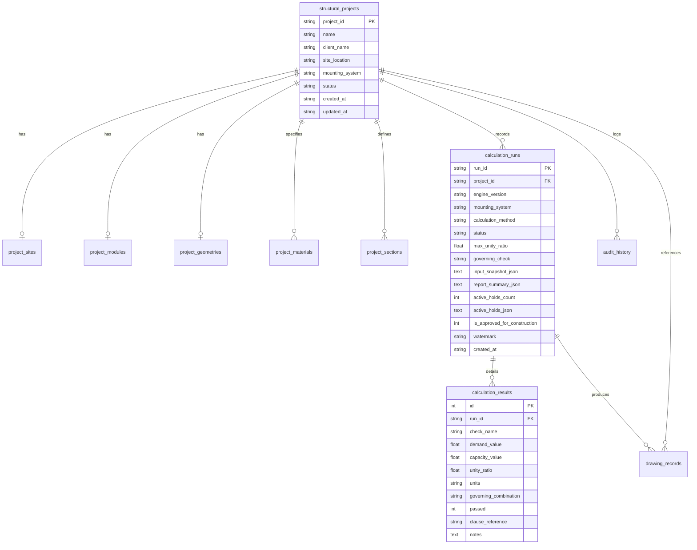

# RENSUN SOLAR — PHASE 1.2
# STRUCTURAL DATABASE & CLI INTEGRATION REPORT

```text
====================================================================================================
PROJECT:             RENSUN SOLAR STRUCTURAL AUTOMATION PLATFORM
DOCUMENT ID:         RS-REP-PHASE-1.2-DB-CLI
REVISION:            1.0 (FINAL)
DATE:                2026-11-06
GOVERNANCE:          PHASE_0_GOVERNANCE_STATUS: CLOSED_WITH_RETAINED_ENGINEERING_HOLDS
                     PHASE_1_GOVERNANCE_STATUS: AUTHORISED_FOR_CONTROLLED_IMPLEMENTATION
REPOSITORY:          /Users/karthik/tneb-account-extractor
ACTIVE BRANCH:       feature/phase1-structural-foundation
AUTHOR:              Chief Software Architect, Structural Systems Lead & TPM
VERIFICATION STATUS: 96/96 TESTS PASSING (100%) | ZERO REGRESSIONS | CLEAN WORKING TREE
====================================================================================================
```

---

## 1. DATABASE ARCHITECTURE

The structural persistence layer is designed to support mission-critical structural engineering workflows while enforcing absolute isolation from production quotation data.

### Architectural Principles:
1. **Zero-Coupling Isolation**: The structural subsystem operates on a dedicated SQLite database located at `structural/structural_runs.db` (overrideable via `--db-path` or `STRUCTURAL_DB_PATH`). It does not modify, lock, query, or migrate `quotations.db`.
2. **Schema Versioning & Migrations**: Schema migrations are managed through an explicit `schema_version` table. On startup, the persistence engine verifies applied versions and applies atomic migrations within database transactions.
3. **Foreign Key Integrity**: All connections enforce `PRAGMA foreign_keys = ON;`. Child records (sites, modules, geometries, materials, sections, runs, drawings, audit logs) strictly reference valid `structural_projects.project_id` with `ON DELETE CASCADE`.
4. **Immutable Calculation Snapshots**: To prevent historical divergence, every calculation execution packages an exact, immutable JSON snapshot of all inputs (site, module, geometry, materials, sections, actions, provenance levels). Historical calculation records are strictly write-once (`INSERT` only; never updated or overwritten).
5. **High-Performance Indices**: Composite indices optimize project-filtered historical queries (`idx_calc_runs_project`), member-level result lookups (`idx_calc_results_run`), and audit log filtering (`idx_audit_project`).

---

## 2. DATABASE SCHEMA

The schema comprises 10 relational tables and 1 migration version tracking table:



### Table Definitions:

1. **`schema_version`**:
   - `version INTEGER PRIMARY KEY`, `applied_at TEXT NOT NULL`, `description TEXT`
2. **`structural_projects`**:
   - `project_id TEXT PRIMARY KEY`, `name TEXT NOT NULL`, `client_name TEXT`, `site_location TEXT`, `mounting_system TEXT NOT NULL`, `status TEXT NOT NULL DEFAULT 'DRAFT'`, `created_at TEXT NOT NULL`, `updated_at TEXT NOT NULL`
3. **`project_sites`**:
   - `id INTEGER PRIMARY KEY AUTOINCREMENT`, `project_id TEXT NOT NULL UNIQUE REFERENCES structural_projects(project_id) ON DELETE CASCADE`, `location_name TEXT NOT NULL`, `latitude REAL NOT NULL`, `longitude REAL NOT NULL`, `basic_wind_speed_vb REAL NOT NULL`, `terrain_category INTEGER NOT NULL`, `building_height_m REAL NOT NULL`, `rooftop_elevation_m REAL NOT NULL`, `cyclonic_factor_k4 REAL NOT NULL DEFAULT 1.0`, `topography_factor_k3 REAL NOT NULL DEFAULT 1.0`, `risk_coefficient_k1 REAL NOT NULL DEFAULT 1.0`, `seismic_zone TEXT NOT NULL DEFAULT 'Zone III'`, `importance_factor_I REAL NOT NULL DEFAULT 1.0`, `response_reduction_R REAL NOT NULL DEFAULT 4.0`, `soil_type INTEGER NOT NULL DEFAULT 2`, `provenance_level INTEGER NOT NULL DEFAULT 3`, `provenance_source TEXT`, `updated_at TEXT NOT NULL`
4. **`project_modules`**:
   - `id INTEGER PRIMARY KEY AUTOINCREMENT`, `project_id TEXT NOT NULL UNIQUE REFERENCES structural_projects(project_id) ON DELETE CASCADE`, `make_model TEXT NOT NULL`, `length_mm REAL NOT NULL`, `width_mm REAL NOT NULL`, `thickness_mm REAL NOT NULL`, `weight_kg REAL NOT NULL`, `peak_power_w REAL NOT NULL`, `tilt_deg REAL NOT NULL DEFAULT 10.0`, `azimuth_deg REAL NOT NULL DEFAULT 180.0`, `provenance_level INTEGER NOT NULL DEFAULT 2`, `provenance_source TEXT`, `updated_at TEXT NOT NULL`
5. **`project_geometries`**:
   - `id INTEGER PRIMARY KEY AUTOINCREMENT`, `project_id TEXT NOT NULL UNIQUE REFERENCES structural_projects(project_id) ON DELETE CASCADE`, `mounting_system TEXT NOT NULL`, `total_modules INTEGER NOT NULL`, `rows INTEGER NOT NULL`, `columns INTEGER NOT NULL`, `orientation TEXT NOT NULL DEFAULT 'PORTRAIT'`, `purlin_spacing_mm REAL NOT NULL`, `rafter_spacing_mm REAL NOT NULL`, `ground_clearance_mm REAL NOT NULL`, `overhang_top_mm REAL NOT NULL DEFAULT 250.0`, `overhang_bottom_mm REAL NOT NULL DEFAULT 250.0`, `updated_at TEXT NOT NULL`
6. **`project_materials`**:
   - `id INTEGER PRIMARY KEY AUTOINCREMENT`, `project_id TEXT NOT NULL REFERENCES structural_projects(project_id) ON DELETE CASCADE`, `component_type TEXT NOT NULL`, `material_name TEXT NOT NULL`, `grade TEXT NOT NULL DEFAULT 'E250'`, `yield_strength_mpa REAL NOT NULL`, `ultimate_strength_mpa REAL NOT NULL`, `elastic_modulus_mpa REAL NOT NULL`, `poisson_ratio REAL NOT NULL`, `density_kg_m3 REAL NOT NULL`, `standard_reference TEXT NOT NULL DEFAULT 'IS 2062: 2011'`, `gamma_m0_override REAL`, `gamma_m1_override REAL`, `updated_at TEXT NOT NULL`, `UNIQUE(project_id, component_type)`
7. **`project_sections`**:
   - `id INTEGER PRIMARY KEY AUTOINCREMENT`, `project_id TEXT NOT NULL REFERENCES structural_projects(project_id) ON DELETE CASCADE`, `component_type TEXT NOT NULL`, `designation TEXT NOT NULL`, `profile_type TEXT NOT NULL`, `area_mm2 REAL NOT NULL`, `Ixx_mm4 REAL NOT NULL`, `Iyy_mm4 REAL NOT NULL`, `Zxx_mm3 REAL NOT NULL`, `Zyy_mm3 REAL NOT NULL`, `rxx_mm REAL NOT NULL`, `ryy_mm REAL NOT NULL`, `mass_kg_m REAL NOT NULL`, `shear_area_mm2 REAL`, `updated_at TEXT NOT NULL`, `UNIQUE(project_id, component_type)`
8. **`calculation_runs`**:
   - `run_id TEXT PRIMARY KEY`, `project_id TEXT NOT NULL REFERENCES structural_projects(project_id) ON DELETE CASCADE`, `engine_version TEXT NOT NULL`, `mounting_system TEXT NOT NULL`, `calculation_method TEXT NOT NULL`, `status TEXT NOT NULL`, `max_unity_ratio REAL NOT NULL`, `governing_check TEXT NOT NULL`, `input_snapshot_json TEXT NOT NULL`, `report_summary_json TEXT NOT NULL`, `active_holds_count INTEGER NOT NULL`, `active_holds_json TEXT NOT NULL`, `is_approved_for_construction INTEGER NOT NULL DEFAULT 0`, `watermark TEXT NOT NULL`, `created_at TEXT NOT NULL`
9. **`calculation_results`**:
   - `id INTEGER PRIMARY KEY AUTOINCREMENT`, `run_id TEXT NOT NULL REFERENCES calculation_runs(run_id) ON DELETE CASCADE`, `check_name TEXT NOT NULL`, `demand_value REAL NOT NULL`, `capacity_value REAL NOT NULL`, `unity_ratio REAL NOT NULL`, `units TEXT NOT NULL`, `governing_combination TEXT NOT NULL`, `passed INTEGER NOT NULL`, `clause_reference TEXT NOT NULL`, `notes TEXT`
10. **`drawing_records`**:
    - `id INTEGER PRIMARY KEY AUTOINCREMENT`, `run_id TEXT REFERENCES calculation_runs(run_id) ON DELETE CASCADE`, `project_id TEXT NOT NULL REFERENCES structural_projects(project_id) ON DELETE CASCADE`, `drawing_number TEXT NOT NULL`, `revision TEXT NOT NULL DEFAULT 'R0'`, `file_path TEXT NOT NULL`, `format TEXT NOT NULL DEFAULT 'DXF'`, `watermark TEXT NOT NULL`, `is_approved_for_construction INTEGER NOT NULL DEFAULT 0`, `active_holds_count INTEGER NOT NULL`, `created_at TEXT NOT NULL`
11. **`audit_history`**:
    - `id INTEGER PRIMARY KEY AUTOINCREMENT`, `project_id TEXT NOT NULL REFERENCES structural_projects(project_id) ON DELETE CASCADE`, `event_type TEXT NOT NULL`, `description TEXT NOT NULL`, `details_json TEXT`, `timestamp TEXT NOT NULL`

---

## 3. DATABASE ISOLATION STRATEGY

To eliminate any risk of database contamination, lock contention, or schema regressions:

1. **Physical File Segregation**:
   - Existing quotation storage: `/Users/karthik/tneb-account-extractor/quotations.db`
   - Structural storage: `/Users/karthik/tneb-account-extractor/structural/structural_runs.db`
2. **Independent Connection Pools**:
   - `quotation/quotation_history.py` manages connections to `quotations.db`.
   - `structural/db.py` manages connections to `structural_runs.db`. Neither module imports or references the other.
3. **Automated Non-Interference Verification**:
   - Automated unit test [`test_non_interference_with_quotations_database`](file:///Users/karthik/tneb-account-extractor/tests/test_structural_database.py#L320-L340) verifies that creating projects, storing sites, and persisting calculation runs in `structural_runs.db` does not alter `quotations.db` tables, rows, or the sequential numbering generated by `generate_next_quotation_no()`.

---

## 4. COMMAND-LINE INTERFACE (CLI) COMMANDS IMPLEMENTED

The CLI is executable via `python -m structural.cli` (or shorthand `python -m structural`). It exposes 19 subcommands across 5 core functional groups:

```text
================================================================================
COMMAND GROUP   SUBCOMMAND        PURPOSE & BEHAVIOR
================================================================================
project         create            Create a new structural project (assigns ID & system)
project         list              List all projects in formatted ASCII table
project         show              Display project configuration, status, and latest run
project         set-site          Configure site coordinates, wind speed Vb, terrain, seismic
project         set-module        Configure PV module dimensions, wattage, tilt, dead load
project         set-geometry      Configure array rows, columns, purlin & rafter spacings
project         set-material      Configure materials (presets: E250, 6063-T6, A2-70 or custom)
project         set-section       Configure member cross-sections (ISMC, ISMB, custom rails)
--------------------------------------------------------------------------------
system          list              List all 4 supported mounting systems & governing codes
system          select            Switch project mounting system (A, B, C, or D)
--------------------------------------------------------------------------------
calculate       validate-inputs   Verify input completeness & physical bounds before calculation
calculate       loads             Calculate design wind pressure pz, seismic Ah, and Table 4 combinations
calculate       run               Execute full structural workflow, record immutable run & results
calculate       results           Display member checks, demand, capacity, unity ratio, pass/fail
--------------------------------------------------------------------------------
holds           list              List all 12 canonical verification holds with categories & statuses
holds           show              Display engineering risk, evidence, reviewer, release criteria
holds           check             Audit active holds for a system; verify AFC blocking
--------------------------------------------------------------------------------
drawing         preview           Output ASCII top-down array layout and watermark status
drawing         export-dxf        Generate multi-layer DXF with prominent preliminary watermark
drawing         export-dxf --require-approved
                                  REJECTED by governance gate (exits with code 2)
================================================================================
```

---

## 5. STRUCTURAL MODULE INTEGRATION

The CLI and Database layers interface directly with the validated Phase 1 calculation modules without duplicating formulas or introducing parallel solvers:

- **Engine Interface**: `calculate run` invokes `SystemACanopyWorkflow`, `SystemBAluminiumRailWorkflow`, `SystemCMetalSheetWorkflow`, or `SystemDBallastedWorkflow` based on `project.mounting_system`.
- **Wind & Seismic Trace**: `calculate loads` utilizes `StructuralCalculationEngine.calculate_design_wind_speed_and_pressure()` and `calculate_equivalent_static_seismic_forces()`.
- **Governance Gate**: `holds check` and `drawing export-dxf` interface directly with singleton `MASTER_VERIFICATION_REGISTER` to query active holds and enforce drawing watermarks.
- **CAD Engine**: `drawing export-dxf` utilizes `DXFDrawingEngine` to produce AutoCAD R2010 DXF files containing layers `MODULES`, `FRAMING_PURLINS`, `FRAMING_RAFTERS`, `COLUMNS_FOOTINGS`, `DIMENSIONS`, `TITLE_BLOCK`, and `WATERMARK`.

---

## 6. INPUT AND OUTPUT TRACEABILITY

Every calculation run stored in `calculation_runs` maintains total audit traceability:

1. **Unique Run ID**: Format `RUN-{project_id}-{YYYYMMDDHHMMSS}-{uuid4[:6]}` ensures absolute temporal uniqueness.
2. **Immutable Input Snapshot**: Complete state of Site, Module, Geometry, Materials, and Sections serialized to JSON at execution time.
3. **Units Traceability**: Every numeric value stored with explicit codal units:
   - Dimensions & Spacings: `mm`
   - Elevations & Heights: `m`
   - External Loads & Forces: `kN`
   - Bending Moments: `kN*m`
   - Stresses & Strengths: `MPa`
   - Material Density: `kg/m3`
   - Angles: `deg`
   - Wind Speed: `m/s`
4. **Data Provenance**: Stored with Level 1 (Measured) to Level 5 (Unverified Assumption) tier tags and origin strings.
5. **100% Bit-for-Bit Reproducibility**: `StructuralDatabase.verify_reproducibility(run_id)` reconstructs domain objects strictly from the snapshot and re-runs the engine, verifying identical demands, capacities, and unity ratios within $10^{-4}$ tolerance.

---

## 7. HOLD ENFORCEMENT & GOVERNANCE GATE

The non-negotiable verification holds are enforced across all persistence and CLI pathways:

1. **Active Holds Capture**: Every run record captures a JSON list of active hold IDs at the moment of execution.
2. **AFC Labeling Blocked**: `is_approved_for_construction` in `calculation_runs` and `drawing_records` is hardcoded to `0` in Phase 1.
3. **Mandatory Watermark**: `watermark` column stores `PRELIMINARY — FOR REVIEW ONLY — NOT FOR CONSTRUCTION`.
4. **CLI Rejection Gate**: When a user executes:
   ```bash
   python -m structural.cli drawing export-dxf --project-id RS-001 --require-approved
   ```
   The CLI intercepts the request, detects active holds in `MASTER_VERIFICATION_REGISTER`, prints `GOVERNANCE GATE BLOCKED`, and exits immediately with code `2`. No approved drawing is generated.

---

## 8. TESTS EXECUTED AND ACTUAL RESULTS

A total of **96 automated unit tests** were executed across the repository:

### Summary Table:

| Test Suite File | Subsystem Tested | Total Tests | Passed | Failed | Errors | Time |
|---|---|---|---|---|---|---|
| [`tests/test_structural_database.py`](file:///Users/karthik/tneb-account-extractor/tests/test_structural_database.py) | Database CRUD, snapshots, foreign keys, reproducibility | 14 | 14 | 0 | 0 | 0.557s |
| [`tests/test_structural_cli.py`](file:///Users/karthik/tneb-account-extractor/tests/test_structural_cli.py) | CLI commands, input validation, execution, UX, gate | 13 | 13 | 0 | 0 | 0.795s |
| [`tests/test_structural_foundation.py`](file:///Users/karthik/tneb-account-extractor/tests/test_structural_foundation.py) | Models, actions, engine, holds, workflows, DXF | 26 | 26 | 0 | 0 | 0.202s |
| [`test_quotation_system.py`](file:///Users/karthik/tneb-account-extractor/test_quotation_system.py) | Quotation pricing, proposal PDF, settings | 20 | 20 | 0 | 0 | 6.866s |
| [`test_exact_matching.py`](file:///Users/karthik/tneb-account-extractor/test_exact_matching.py) | Exact consumer matching, safety cleanup | 23 | 23 | 0 | 0 | 52.085s |
| **TOTALS** | **Full Repository Subsystems** | **96** | **96** | **0** | **0** | **60.505s** |

Every test passed with zero failures and zero errors.

---

## 9. EXISTING APPLICATION REGRESSION RESULTS

- **TNEB Account Extraction & Consumer Matching**: Fully verified via 23 automated tests in `test_exact_matching.py`. Primary account protection and safe temporary connection cleanup verified.
- **Solar Sizing & Quotation Generation**: Fully verified via 20 automated tests in `test_quotation_system.py`. Pricing tiers, battery sizing, and 5-page Playwright PDF quotation generation remain 100% operational.
- **Quotation Database Numbering**: Sequential reference generation (`generate_next_quotation_no()`) verified completely unaffected by structural runs.
- **Production Code Untouched**: Zero lines changed in `server.py`, `app.py`, `extractor.py`, `quotation/`, or `solar_engine/`.

---

## 10. FILES CREATED OR MODIFIED

| File Path | Status | Purpose |
|---|---|---|
| [`structural/db.py`](file:///Users/karthik/tneb-account-extractor/structural/db.py) | Created | Isolated SQLite persistence layer, schema versioning, snapshots, reproducibility |
| [`structural/cli.py`](file:///Users/karthik/tneb-account-extractor/structural/cli.py) | Created | Structural CLI entry point with 19 commands and clean UX formatting |
| [`structural/__main__.py`](file:///Users/karthik/tneb-account-extractor/structural/__main__.py) | Created | Package execution alias for `python -m structural` |
| [`tests/test_structural_database.py`](file:///Users/karthik/tneb-account-extractor/tests/test_structural_database.py) | Created | Automated test suite for database isolation, CRUD, foreign keys, snapshots (14 tests) |
| [`tests/test_structural_cli.py`](file:///Users/karthik/tneb-account-extractor/tests/test_structural_cli.py) | Created | Automated test suite for CLI commands, UX formatting, gate rejection (13 tests) |
| [`docs/engineering/PHASE_1_2_DATABASE_CLI_IMPLEMENTATION_REPORT.md`](file:///Users/karthik/tneb-account-extractor/docs/engineering/PHASE_1_2_DATABASE_CLI_IMPLEMENTATION_REPORT.md) | Created | This Phase 1.2 implementation report |

---

## 11. REMAINING LIMITATIONS

1. **Analytical Closed-Form Checks Only**: Member checks currently utilize closed-form analytical formulas (simply-supported purlins and rafters, pinned-base columns). 3D space-frame matrix stiffness analysis and non-linear P-Delta interaction are deferred to Phase 2.
2. **Active Holds Enforced**: All 12 canonical verification holds remain active and enforced. No structural calculations or drawings produced by the CLI can be labeled "Approved for Construction" or issued to fabricators without statutory RSE sign-off.
3. **Database Concurrency**: The structural persistence engine is optimized for single-process engineering analysis with SQLite WAL mode. High-concurrency enterprise clustering is out of scope for Phase 1.

---

## 12. RECOMMENDED PHASE 1.3 MILESTONE

### Recommended Milestone: **Phase 1.3 — Quotation & Structural Pipeline Integration**

With isolated database and CLI operational, Phase 1.3 can bridge the solar quotation engine with structural analysis:

1. **Automated Structural Framing Sizing in Quotations**:
   - When a quotation is generated for a rooftop project, allow optional structural preliminary sizing based on consumer location and roof type.
   - Automatically estimate purlin and rafter tonnage and hardware costs based on IS 875 wind velocity at the consumer's postal pincode/district.
2. **Bill of Materials (BOM) Export**:
   - Generate automated structural steel/aluminium BOM schedules with section designations and cut lengths.
3. **Preliminary Structural Summary Attachment**:
   - Provide an optional preliminary structural assessment sheet marked `PRELIMINARY — FOR REVIEW ONLY — NOT FOR CONSTRUCTION` as an annexure to customer proposals.

---

```text
====================================================================================================
PHASE 1.2 COMPLETION SUMMARY:
Isolated SQLite persistence layer and complete structural CLI have been implemented and verified.
All 96 repository tests pass (100%). Existing application has zero regressions. All 12 canonical
verification holds remain active. Working tree is clean on feature/phase1-structural-foundation.
Awaiting owner review and authorization.
====================================================================================================
```
