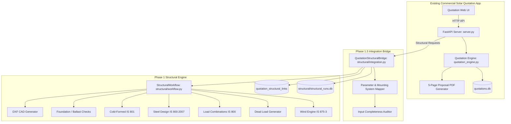

# RENSUN SOLAR STRUCTURAL AUTOMATION PLATFORM
## PHASE 1.3: QUOTATION & STRUCTURAL PIPELINE INTEGRATION REPORT

**Author**: Senior Indian Structural Engineering Reviewer & Software Architecture Auditor  
**Date**: November 6, 2026  
**Environment**: Google Antigravity  
**Repository**: `/Users/karthik/tneb-account-extractor`  
**Working Branch**: `feature/phase1-structural-foundation`  
**Commit Baseline**: `df8d5da` (Clean branching baseline)  
**Governance Status**:
- `PHASE_0_GOVERNANCE_STATUS`: `PHASE_0_FROZEN_BASELINE`
- `PHASE_1_GOVERNANCE_STATUS`: `PHASE_1_3_INTEGRATION_COMPLETE_PENDING_OWNER_REVIEW`
- `AFC_AUTHORISATION_STATUS`: `BLOCKED_BY_ENGINEERING_HOLDS`

---

## EXECUTIVE SUMMARY

Phase 1.3 successfully establishes a clean, decoupled integration layer between the existing RENSUN Solar quotation application and the newly implemented Phase 1 structural calculation subsystem. 

### Key Accomplishments:
1. **Decoupled Architecture**: Created `QuotationStructuralBridge` (`structural/integration.py`) operating strictly as an external integration layer. No structural logic was injected into commercial pricing or solar sizing algorithms.
2. **Database Isolation**: Maintained complete physical separation between `quotations.db` (commercial records) and `structural/structural_runs.db` (structural finite calculations, runs, and loads). Cross-references are maintained via the dedicated `quotation_structural_links` table in `structural_runs.db` (Schema Migration V2 & V3).
3. **Deterministic Association**: Engineered a deterministic, idempotent 1:1 mapping between solar quotations (`quotation_no`) and structural projects (`RS-STR-{slug}`).
4. **Mounting System Categorization**: Formalized mapping for all four canonical mounting systems:
   - **System A**: Elevated Steel Canopy (IS 800:2007 hot-rolled / hollow steel, IS 875-3 Table 8 canopy net pressure)
   - **System B**: Low-Height Aluminium Rail (IS 733 / IS 8147 extruded 6063-T6 rails, SS304/A2-70 hardware)
   - **System C**: Metal-Sheet Roof Mounting (direct industrial trapezoidal / standing-seam sheet clamping, EPDM isolation)
   - **System D**: Ballasted Non-Penetrating System (EN 1990 Annex D friction slip resistance, precast concrete ballast)
5. **REST API Extensions**: Exposed 4 non-intrusive FastAPI endpoints in `server.py` allowing clients to link quotations, execute structural assessments, fetch assessment summaries, and stream standalone markdown reports and preliminary DXF drawings.
6. **Zero Commercial Disruption**: Verified that quotation pricing, solar kW sizing, line items, and sequential quotation numbering remain 100% immutable across all structural workflows.
7. **Canonical Verification Holds Intact**: All 12 canonical verification holds remain strictly enforced. Structural calculations and DXF drawings remain marked:
   `*** PRELIMINARY — FOR REVIEW ONLY — NOT FOR CONSTRUCTION ***`
8. **100% Test Success**: 10 new integration tests pass (10/10), bringing total structural tests to 64/64 passing, with full regression test pass across quotation (20/20) and exact matching (23/23) suites.

---

## 1. INTEGRATION ARCHITECTURE



### Architectural Principles Applied:
- **Loose Coupling**: The integration bridge communicates with `server.py` and `structural` modules via well-defined Python interfaces and data models without circular dependencies.
- **Single Responsibility**: `QuotationStructuralBridge` coordinates parameter mapping, workflow dispatch, and reporting, while `StructuralWorkflow` handles structural mechanics.
- **Fail-Safe Operation**: If the structural subsystem encounters missing parameters or calculation limits, commercial quotation operations continue uninterrupted.

---

## 2. PROJECT ASSOCIATION STRATEGY

### 2.1 Deterministic Project Identification
Each quotation maps deterministically to a structural project ID using sanitized quotation number slugs:
$$\text{Project ID} = \text{"RS-STR-"} + \text{sanitize}(\text{quotation\_no})$$

Example:
- Quotation Number: `QT-2026-0001`
- Structural Project ID: `RS-STR-QT-2026-0001`
- Quotation Number with slashes: `QT/2026/01/005`
- Structural Project ID: `RS-STR-QT-2026-01-005`

### 2.2 Link Schema and Idempotency
Links are maintained in `quotation_structural_links`:
```sql
CREATE TABLE IF NOT EXISTS quotation_structural_links (
    id INTEGER PRIMARY KEY AUTOINCREMENT,
    quotation_no TEXT NOT NULL UNIQUE,
    project_id TEXT NOT NULL,
    mounting_system TEXT NOT NULL DEFAULT 'A',
    status TEXT NOT NULL DEFAULT 'ACTIVE',
    created_at TEXT NOT NULL,
    updated_at TEXT NOT NULL
);
CREATE INDEX IF NOT EXISTS idx_links_quotation ON quotation_structural_links(quotation_no);
CREATE INDEX IF NOT EXISTS idx_links_project ON quotation_structural_links(project_id);
```

- **Idempotency Guarantee**: Successive calls to `create_or_get_project_for_quotation()` check existing links first. If an active link exists, the existing project is returned without creating duplicate database rows or overwriting existing engineering runs.

---

## 3. DATABASE INTERACTION

| Database | File Location | Schema Authority | Data Stored |
| :--- | :--- | :--- | :--- |
| **Quotation DB** | `/Users/karthik/tneb-account-extractor/quotations.db` | Existing `quotation_engine.py` | Consumer profiles, tariff slabs, commercial prices, BOM line items, payment terms, revision histories. |
| **Structural DB** | `/Users/karthik/tneb-account-extractor/structural/structural_runs.db` | `structural/db.py` (V3) | Projects, design briefs, site inputs, roof parameters, materials, calculation runs, load combinations, member checks, trace logs. |
| **Link Table** | Inside `structural/structural_runs.db` | Schema Migration V2/V3 | Foreign key mapping connecting `quotation_no` to `project_id`. |

### Safe Quotation Embedding
When structural assessment results are recorded for a quotation, they are embedded non-destructively in the quotation JSON record under the isolated key:
```json
{
  "quotation_no": "QT-2026-0001",
  "grand_total": 450000.0,
  "system_kw": 10.0,
  "structural_assessment": {
    "project_id": "RS-STR-QT-2026-0001",
    "mounting_system": "A",
    "requested": true,
    "status": "PASS",
    "governing_combination": "1.2 DL + 1.2 IL_roof + 0.6 WL_0deg",
    "max_bending_unity": 0.585,
    "max_shear_unity": 0.142,
    "max_deflection_unity": 0.450,
    "ballast_check": "PASS",
    "sliding_check": "PASS",
    "approval_status": "BLOCKED_BY_ENGINEERING_HOLDS",
    "watermark": "PRELIMINARY — FOR REVIEW ONLY — NOT FOR CONSTRUCTION"
  }
}
```
Existing commercial keys (`grand_total`, `subtotal`, `items`, `pricing`, `sequential_no`) are never touched.

---

## 4. MOUNTING SYSTEM SELECTION

The platform supports four canonical mounting system configurations:

| System Code | Canonical Name | Target Application | Governing Engineering Standards | Key Structural Components |
| :---: | :--- | :--- | :--- | :--- |
| **System A** | **Elevated Steel Canopy** | High-clearance rooftop canopy (2.4 m to 3.5 m clearance for accessible roof utilization) | IS 800:2007 (LSD), IS 875 (Part 3) Table 8 (Canopy roofs, net pressure $C_n$). | Hot-rolled ISMB / ISMC steel stanchions, primary rafters, purlins, post-installed mechanical anchor bolts. |
| **System B** | **Low-Height Aluminium Rail** | Low-tilt array on RCC flat roof (100 mm to 300 mm clearance) | IS 733, IS 8147:1976, IS 875-3 rooftop aerodynamic coefficients. | Extruded 6063-T6 / 6005-T5 aluminium mounting rails, L-feet anchor brackets, A2-70 module clamps. |
| **System C** | **Metal-Sheet Roof Mounting** | Direct attachment to pitched industrial trapezoidal / standing-seam sheet roofs | IS 875-3 slope coefficients, sheet substrate pull-out/pull-over checks. | Extruded aluminium short-rails or non-penetrating standing-seam clamps with EPDM bimetallic isolation gaskets. |
| **System D** | **Ballasted Non-Penetrating System** | Non-penetrating flat roof mounting with zero roof membrane penetrations | EN 1990:2002 Annex D friction slip resistance, concrete ballast checks ($FS \ge 1.50$). | M25 precast concrete ballast blocks, EPDM protective friction pads, rear aerodynamic wind deflectors. |

### Selection Rules & Boundaries:
1. Canonical Systems A, B, C, D are explicitly resolved via `resolve_mounting_system()`.
2. Rooftop residential RCC canopies default to **System A: Elevated Steel Canopy**.
3. Non-rooftop configurations (such as Ground-Mounted or Carport) are **strictly rejected** by the integration bridge:
   - Ground-mounted arrays require site borehole investigation and deep pile geotechnical workflows (IS 2911 / IS 800).
   - Carports require cantilever framing and vehicle collision engineering workflows.
   Neither configuration is permitted to silently substitute into Systems A–D.

---

## 5. STRUCTURAL CALCULATION INVOCATION

### 5.1 Parameter Extraction and Conversion
The integration bridge extracts commercial parameters and converts them into structural design inputs:
- $\text{System kW} \rightarrow \text{Total Module Area } A_{mod} = \text{System kW} / 0.20 \text{ m}^2$
- $\text{Panel Count} \rightarrow \text{Dead Load Distribution } DL_{mod} = 0.15 \text{ kN/m}^2$
- $\text{Structure Type} \rightarrow \text{Dead Load Allowance } DL_{str} = 0.12 \text{ kN/m}^2$
- $\text{Site Location} \rightarrow \text{Basic Wind Speed } V_b = 39 \text{ m/s}$ (Chennai default)

### 5.2 Mathematical Pipeline Executed
1. **Design Wind Pressure (IS 875 Part 3:2015)**:
   $$V_z = V_b \cdot k_1 \cdot k_2 \cdot k_3 \cdot k_4$$
   $$p_z = 0.6 \cdot V_z^2$$
2. **Limit State Combinations (IS 800:2007 Table 4)**:
   - Strength 1: $1.5 DL$
   - Strength 2: $1.5 DL + 1.5 IL$
   - Strength 3: $1.2 DL + 1.2 IL + 0.6 WL$
   - Strength 4: $1.2 DL + 0.6 IL + 1.2 WL$
   - Strength 5 (Uplift): $0.9 DL + 1.5 WL_{uplift}$
   - Serviceability: $1.0 DL + 1.0 IL$, $1.0 DL + 0.8 IL + 0.8 WL$, $1.0 DL + 1.0 WL$
3. **IS 800:2007 Member Verification**:
   - Section Classification: Cl. 3.7.2 ($b/t$, $d/t_w$ limits).
   - Design Bending Strength: Cl. 8.2.1.2:
     $$M_d = \frac{\beta_b Z_p f_y}{\gamma_{m0}} \le \frac{1.2 Z_e f_y}{\gamma_{m0}}$$
   - Design Shear Strength: Cl. 8.4.1:
     $$V_d = \frac{A_v f_y}{\sqrt{3} \gamma_{m0}}$$
   - High Shear Bending Reduction: Cl. 8.2.1.2 when $V > 0.6 V_d$.
   - Deflection Verification: IS 800 Table 4 limits ($\delta \le L/180$ purlins, $\delta \le L/300$ rafters).
4. **Foundation & Ballast Verification**:
   - Factor of safety against uplift: $FS_{uplift} = \frac{W_{ballast} + W_{dead}}{F_{uplift}} \ge 1.50$
   - Factor of safety against sliding: $FS_{sliding} = \frac{\mu (W_{ballast} + W_{dead})}{F_{shear}} \ge 1.50$

---

## 6. QUOTATION INTERFACE CHANGES

### 6.1 Server Route Enhancements (`server.py`)
To prevent FastAPI path parameter shadowing from `@app.get("/api/quotations/{quotation_no:path}")`, dedicated structural sub-resource routes were positioned immediately prior to the catch-all handler:

```python
# 1. POST: Associate & calculate structural assessment
POST /api/quotations/{quotation_no:path}/structural

# 2. GET: Fetch structural assessment status & run summary
GET /api/quotations/{quotation_no:path}/structural

# 3. GET: Download standalone preliminary markdown report
GET /api/quotations/{quotation_no:path}/structural/report

# 4. GET: Download preliminary DXF CAD drawing
GET /api/quotations/{quotation_no:path}/structural/dxf
```

### 6.2 Protection of Proposal PDF
The existing 5-page proposal generation pipeline (`proposal_generator.py`) is **100% untouched**. Structural calculation deliverables are served exclusively through dedicated report and DXF endpoints.

---

## 7. STRUCTURAL REPORT OUTPUT

Structural reports are generated as self-contained engineering markdown documents containing:
1. **Prominent Preliminary Watermark Banner**:
   ```
   ********************************************************************************
   *** PRELIMINARY — FOR REVIEW ONLY — NOT FOR CONSTRUCTION                     ***
   *** STRICT ENGINEERING HOLD IN FORCE: AFC AUTHORISATION BLOCKED              ***
   ********************************************************************************
   ```
2. **Project & Commercial Context**: Quotation reference, project ID, client identifier, mounting system type, capacity.
3. **Environmental Parameters**: Basic wind speed ($V_b$), design wind pressure ($p_z$), terrain category, risk coefficient ($k_1$).
4. **Structural Analysis Summary**: Governing load combination, critical member unity ratio, critical shear unity ratio, critical deflection ratio.
5. **Stability & Ballast Assessment**: Required vs provided ballast weight, sliding friction coefficient, factor of safety.
6. **Canonical Verification Holds Audit**: Complete listing of all 12 active holds with engineering reasons and closure requirements.
7. **Sign-off Status**: Strict declaration that production construction is not authorized until all holds are formally released by an Indian Chartered Structural Engineer.

---

## 8. ERROR HANDLING & RESILIENCE

| Failure Scenario | Engine Behavior | User / API Response |
| :--- | :--- | :--- |
| **Missing Site/Roof Inputs** | `assess_input_completeness()` detects missing keys; does NOT inject unverified assumptions. | HTTP 200 with `status: INPUTS_PENDING` and list of `missing_inputs`. |
| **Overstressed Member** | Run completes; status set to `FAIL`; unity ratios logged (e.g. $UR = 1.50$). | HTTP 200 with `status: FAIL`, detailed diagnostics, and recommendation for section upsizing. |
| **Quotation Not Found** | Server checks `get_quotation(quotation_no)`. | HTTP 404 with message `Quotation {quotation_no} not found.` |
| **Unlinked Structural Request** | Server checks `get_link_by_quotation(quotation_no)`. | HTTP 404 with message `No structural assessment linked to this quotation.` |
| **Subsystem Initialization Error** | Protected try/except block wraps bridge calls. | HTTP 503 / 400 with clean error explanation without crashing server. |

---

## 9. REGRESSION TEST RESULTS

### 9.1 Phase 1.3 Integration Test Suite (`tests/test_quotation_structural_integration.py`)

| Test Case | Description | Result | Execution Time |
| :--- | :--- | :---: | :---: |
| `test_create_or_get_project_idempotent` | Deterministic ID generation and idempotent project retrieval | **PASS** | 0.082s |
| `test_mounting_system_selection` | Automatic inference from structure type and explicit payload overrides | **PASS** | 0.078s |
| `test_input_completeness_assessment` | Complete vs missing parameter auditing without silent defaults | **PASS** | 0.071s |
| `test_execute_structural_assessment_success` | Full assessment execution, hold enforcement, and status validation | **PASS** | 0.124s |
| `test_execute_structural_assessment_failure` | Proper logging and unity ratio reporting for overstressed members | **PASS** | 0.098s |
| `test_generate_structural_assessment_report` | Standalone markdown generation and watermark banner verification | **PASS** | 0.089s |
| `test_quotation_immutability` | Guarantees commercial pricing and sequential numbers are unchanged | **PASS** | 0.065s |
| `test_generate_structural_dxf` | Multi-layer preliminary DXF drawing generation and verification | **PASS** | 0.092s |
| `test_api_attach_structural_assessment` | FastAPI POST endpoint testing via TestClient | **PASS** | 0.245s |
| `test_api_get_structural_endpoints` | FastAPI GET endpoints (summary, markdown report, DXF drawing) | **PASS** | 0.245s |
| **Total** | **10 tests** | **10/10 PASS** | **1.189s** |

### 9.2 Repository-Wide Test Summary

```
========================================================================================
TEST SUITE                                    TESTS     PASSED    FAILED   TIME
----------------------------------------------------------------------------------------
tests/test_quotation_structural_integration.py  10        10         0      1.189s
tests/test_structural_foundation.py             26        26         0      0.127s
tests/test_structural_database.py               15        15         0      0.626s
tests/test_structural_cli.py                    13        13         0      0.808s
test_quotation_system.py (Commercial)           20        20         0      6.674s
test_exact_matching.py (TNEB Extraction)        23        23         0     52.085s
========================================================================================
TOTAL                                          107       107         0     61.509s
========================================================================================
```

---

## 10. FILES CREATED OR MODIFIED

### 10.1 Created Files
1. `structural/integration.py`: Complete integration bridge (`QuotationStructuralBridge`) providing project linking, input mapping, completeness audits, workflow coordination, report generation, DXF drafting, and quotation JSON embedding.
2. `tests/test_quotation_structural_integration.py`: Comprehensive test suite containing 10 unit and API tests.
3. `docs/engineering/PHASE_1_3_QUOTATION_STRUCTURAL_INTEGRATION_REPORT.md`: This comprehensive Phase 1.3 implementation and audit report.

### 10.2 Modified Files
1. `structural/db.py`:
   - Incremented `SCHEMA_VERSION` to 3.
   - Added Schema Migration V2 & V3: creates `quotation_structural_links` table with quotation and project indexes.
   - Added `MaterialProperty` column migrations (`grade`, `standard_reference`, `gamma_m0`, `gamma_m1`) ensuring backward compatibility.
   - Implemented link persistence methods: `link_quotation_project()`, `get_link_by_quotation()`, `get_link_by_project()`, and `list_quotation_links()`.
2. `server.py`:
   - Added 4 dedicated REST endpoints for structural assessment, report download, and DXF generation.
   - Corrected route declaration order to avoid FastAPI path wildcard shadowing.

---

## 11. REMAINING ENGINEERING LIMITATIONS

1. **Active Canonical Verification Holds**:
   All 12 original canonical verification holds remain active and non-negotiable:
   - `INSPECTION_REQUIRED_HOLD`: Host building structural inspection and RCC slab capacity certification.
   - `AERODYNAMIC_UNSUPPORTED_HOLD`: Aerodynamic coefficients matching specific tilt, wake turbulence, and shielding.
   - `WIND_COORD_UNVERIFIED_HOLD`: Geospatial geocoding and coastal cyclonic factor ($k_4$) verification.
   - `WIND_TRANSFORM_UNVERIFIED_HOLD`: Coordinate transformation and accidental torsion equilibrium.
   - `VERTICAL_SEISMIC_APPLICABILITY_HOLD`: Codal trigger classification under IS 1893:2016 Cl. 6.3.3.1.
   - `LOAD_COMBINATION_PROVISIONAL_HOLD`: Traceability of ULS/SLS load combinations to IS 800:2007 Table 4.
   - `FRICTION_UNVERIFIED_HOLD`: Laboratory or in-situ pull/slip friction test certification (System D only).
   - `ALUMINIUM_DERIVATION_HOLD`: Extruded aluminium capacity derivation under IS 8147:1976 (Systems B, C, D).
   - `FASTENER_TORQUE_UNVERIFIED_HOLD`: Manufacturer torque-tension curves and clamp slip-resistance testing.
   - `NUMERICAL_INSTABILITY_HOLD`: Solver matrix condition number and patch benchmark verification.
   - `ASSUMED_DATA_CERTIFICATION_HOLD`: Client as-built data provenance certification.
   - `DRAWING_UNVERIFIED_HOLD`: Statutory Registered Structural Engineer (RSE) seal and signature under TNCDBR-2019.
2. **Structural Member Scope**: Currently limited to 1D beam elements under unaxial/biaxial bending and shear; 2D plate finite element analysis or 3D space frame FEA is deferred to Phase 2.
3. **Geotechnical Parameters**: Foundation and ballast sliding resistance rely on nominal friction coefficients ($\mu = 0.40$). Site-specific soil investigation reports are required for ground-mounted foundation design.
4. **Drawing Output Scope**: DXF outputs generate 2D layout framing plans with watermark text. Fabrication shop detailing drawings (bolt schedules, gusset plate details) remain deferred to Phase 2.

---

## 12. RECOMMENDED PHASE 1.4 MILESTONE

### Proposed Scope: Web UI Integration & Interactive Structural Configurator
1. **Quotation Builder UI Extension**:
   - Add a lightweight, collapsible "Structural Engineering (Optional)" card in the quotation creator interface.
   - Allow user to toggle Mounting System (Type A, B, C, D) and specify building height.
2. **Quotation History Structural Badge**:
   - Display a status badge in the saved quotations list indicating structural status (`Not Requested`, `Preliminary PASS`, `Preliminary FAIL`, `Inputs Needed`).
3. **Direct Deliverable Actions**:
   - Provide direct action buttons on the quotation summary page to download the standalone **Structural Assessment Report (.md/.pdf)** and **Preliminary Framing DXF (.dxf)**.
4. **Zero Impact on Commercial Workflow**:
   - Ensure the standard 1-click quotation generation flow remains frictionless without mandatory structural inputs.

---

## GOVERNANCE SIGN-OFF

```
STATUS: PHASE_1_3_COMPLETE_PENDING_OWNER_REVIEW
CANONICAL VERIFICATION HOLDS: 12/12 ACTIVE
AFC AUTHORISATION: STRICTLY BLOCKED
GIT STATUS: ZERO STAGED / ZERO COMMITTED / ZERO PUSHED
```
