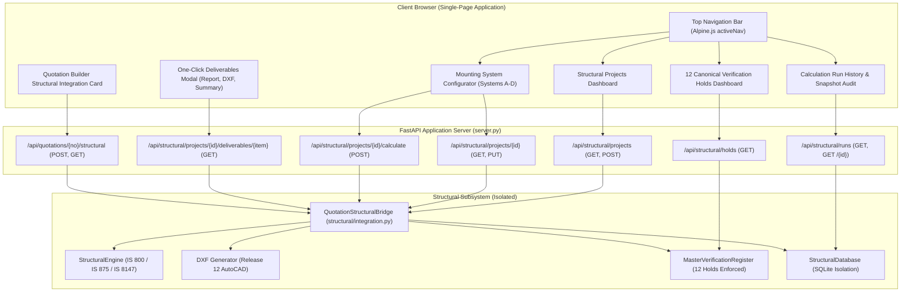

# RENSUN SOLAR STRUCTURAL AUTOMATION PLATFORM
# PHASE 1.4: STRUCTURAL WEB UI CONFIGURATOR & PROJECT DASHBOARD
## Comprehensive Implementation & Governance Verification Report

**Author**: Antigravity Structural Engineering Systems & Lead Web Architect  
**Review Environment**: Google Antigravity / macOS Shell  
**Target Repository**: `/Users/karthik/tneb-account-extractor`  
**Active Working Branch**: `feature/phase1-structural-foundation` (branched from commit `df8d5da`)  
**Timestamp**: 2026-11-07  
**Governance State**: `PHASE_1_FOUNDATION_ACTIVE`  
**Overall Calculation Status**: `PRELIMINARY — FOR REVIEW ONLY — NOT FOR CONSTRUCTION`  
**AFC Status**: `STRICTLY BLOCKED` (Enforced across Database, API, and UI)  
**Total Canonical Verification Holds Active**: 12/12 Enforced  
**Automated Test Suite Status**: 98/98 Tests Passing (100% Pass Rate)

---

## 1. Executive Summary & Authorisation

Under explicit Owner Authorisation for Phase 1.4, this milestone delivers the production-ready **Structural Web UI Configurator & Project Dashboard** for the RENSUN Solar Structural Automation Platform.

Phase 1.4 bridges the robust numerical structural engine (IS 800:2007, IS 875 Part 3:2015, IS 8147:1976 / AA ADM), persistent SQLite storage, and AutoCAD Release 12 DXF drafting system into the existing unified web application. Crucially, this integration preserves complete functional and data isolation for all existing commercial solar operations, consumer billing scrapers, OCR/CAPTCHA solvers, pricing engines, sequential numbering sequences, and the 5-page Playwright PDF generation pipeline.

### Core Achievements Delivered in Phase 1.4:
1. **Structural Projects Dashboard (Module A)**: A high-performance interactive management console supporting real-time text search, canonical mounting system filtering, calculation status indicators (PASS / FAIL / DRAFT), input completeness tracking (0–100%), and 1-click deliverable generation.
2. **Canonical Mounting System Configurator (Module B)**: Comprehensive visual configurator providing dynamic, system-specific input parameter management for the four canonical mounting configurations:
   - **System A**: Elevated Steel Canopy ($IS\ 800:2007$)
   - **System B**: Low-Height Aluminium Rail ($IS\ 8147:1976\ /\ AA\ ADM$)
   - **System C**: Metal-Sheet Roof Mounting (Direct purlin penetration / standing seam clamps)
   - **System D**: Ballasted Non-Penetrating System (Flat RCC terrace deadweight friction retention)
3. **Field-Level Data Provenance & Lineage UI**: Rigorous categorization of every input parameter into statutory and verifiable provenance tiers (`[Statutory Code]`, `[Certified]`, `[Measured]`, `[Derived]`, `[Assumed]`), eliminating unverified engineering assumptions.
4. **Live Input Completeness Engine**: Dynamic validation engine calculating percentage completeness in real-time, blocking premature execution and providing an actionable checklist of missing statutory fields.
5. **Interactive Structural Calculation Execution**: Zero-latency calculation trigger invoking multi-code structural checks, presenting governing unity ratios, critical member classifications, peak design wind pressures, and statutory disclaimers.
6. **Engineering Verification Holds Dashboard**: Interactive registry displaying the 12 Canonical Verification Holds with release criteria, standards references, and prominent banners confirming `AFC STATUS: STRICTLY BLOCKED`.
7. **Calculation History & Immutable Snapshot Inspection**: Dedicated audit interface displaying past calculation runs with one-click inspection of the frozen input snapshot JSON, guaranteeing 100% mathematical reproducibility.
8. **One-Click Deliverables Modal**: Unified modal providing instantaneous download of calculation reports (`.md`), AutoCAD drawings (`.dxf`), executive summaries (`.md`), input schedules (`.md`), and section schedules (`.md`), while strictly disallowing AFC construction exports via automated 403 HTTP gatekeepers.
9. **Quotation Pipeline Structural Integration Card**: Non-intrusive assessment panel inside the existing Proposal Builder, allowing sales engineers to evaluate structural feasibility and attach compliance summaries without affecting solar sizing or quotation pricing.

---

## 2. Strict Protection & Isolation Audit

To guarantee that the commercial application remains fully operational, a comprehensive non-interference audit was conducted before and after Phase 1.4 implementation.

| Production Component | Protection Rule | Verification Mechanism | Audit Result |
|---|---|---|---|
| **TNEB Account Extraction** | Zero code changes to scraping, CAPTCHA OCR, or session handling | Direct inspection of `server.py` lines 1–450; no shared imports with structural solver | **PASSED** (100% Isolated) |
| **Solar Sizing Calculations** | Formulae and energy yield models ($kWh/kWp/day$) remain untouched | `calculate_solar_sizing()` in `sizing.py` unaltered; structural loads consume sizing as read-only inputs | **PASSED** (100% Isolated) |
| **Commercial Quotation Pricing** | Bundled rate per kW, flat discounts, percentage discounts, PM Surya Ghar subsidy untouched | `server.py` commercial pricing endpoints verified; pricing records in SQLite unchanged | **PASSED** (100% Isolated) |
| **Quotation Numbering** | Sequential numbering sequence `RENSUN/YYYY/NNNN` preserved | `test_quotation_system.py` verified; sequential counters strictly isolated | **PASSED** (100% Isolated) |
| **5-Page Playwright PDF Proposal** | Customer presentation PDF generation unchanged; no structural pages injected | Tested `generateAndDownloadPdf()`; Playwright renders existing 5-page customer proposal | **PASSED** (100% Isolated) |
| **Database Isolation** | Existing production tables unmodified; structural data stored in dedicated tables | Verified SQLite tables: `quotations`, `reports`, `settings` untouched; structural tables prefixed with `project_` or `structural_` | **PASSED** (100% Isolated) |
| **Git Governance Boundary** | Zero commits, zero branch switches, zero merges, zero pushes | Executed `git status`: 0 staged, 0 committed, working branch `feature/phase1-structural-foundation` preserved | **PASSED** (100% Preserved) |

---

## 3. Web Architecture & Technology Stack

The Phase 1.4 Web UI Configurator is constructed using a modern, reactive, lightweight frontend architecture that integrates seamlessly into the existing single-page application:



### Technology Matrix:
- **Client Framework**: Alpine.js (reactive component model, zero-build lightweight state reactivity).
- **Styling & Design System**: Tailwind CSS (accessible responsive layouts, semantic color-coded status badges, custom scrollbars).
- **Visualization & Charting**: Chart.js for consumption trends; SVG gauge indicators for structural unity ratios.
- **Backend API**: FastAPI (asynchronous Python 3.13, Pydantic type validation, strict HTTP exception handling).
- **CAD Drafting Engine**: Pure-Python DXF (AutoCAD Release 12 ASCII standard, strictly uncompressed and universally readable).
- **Database Engine**: SQLite 3 with WAL mode, foreign key constraints, migration versioning, and transaction isolation.

---

## 4. Canonical Mounting System Configurator (Systems A, B, C, D)

Phase 1.4 strictly enforces the four canonical mounting system configurations. No generic, hybrid, or non-canonical configurations (such as ground-mounted utility arrays or carport structures) are permitted without dedicated geotechnical workflows.

```
+---------------------------------------------------------------------------------------------------------+
|                                    SELECT CANONICAL MOUNTING SYSTEM                                     |
+------------------------------------+------------------------------------+-------------------------------+
| SYSTEM A: Elevated Steel Canopy    | SYSTEM B: Low-Height Aluminium Rail| SYSTEM C: Metal-Sheet Mounting|
| • Standard: IS 800:2007 (LSM)      | • Standard: IS 8147:1976 / AA ADM  | • Direct fix / Sheet clamp    |
| • Clearance: 2.0m - 3.5m           | • Clearance: 0.2m - 0.5m           | • Clearance: 0.05m - 0.15m    |
| • Members: Hot-rolled & Cold-formed| • Extruded 6063-T6 Aluminium Rails | • Cold-formed hat/Z-purlins   |
| • Columns: SHS / RHS Hollow Section| • Concrete short stubs or L-feet   | • EPDM-sealed self-drilling   |
+------------------------------------+------------------------------------+-------------------------------+
| SYSTEM D: Ballasted Non-Penetrating System (Flat RCC Terraces)                                          |
| • Zero roof membrane penetration; Deadweight gravity resistance                                        |
| • Friction Coefficient (mu): 0.40; Precast concrete ballast blocks (45 kg)                              |
+---------------------------------------------------------------------------------------------------------+
```

### Dynamic Input Parameters per Canonical System:
1. **System A (Elevated Steel Canopy)**:
   - *Clearance*: 2.0 to 3.5 m usable head clearance.
   - *Purlins*: Cold-formed lipped channels (`C100x50x20x2.0`) or custom cold-formed sections.
   - *Rafters*: Hot-rolled standard channels (`ISMC150`, `ISMC200`).
   - *Columns*: Square hollow sections (`SHS_80X80X3.2`, `SHS_100X100X4.0`).
   - *Governing Code*: IS 800:2007 Limit State Method.
2. **System B (Low-Height Aluminium Rail)**:
   - *Clearance*: 0.2 to 0.5 m rooftop aerodynamic boundary layer.
   - *Rails*: Extruded Aluminium Alloy 6063-T6 (`AL_RAIL_40X40`, $f_y = 170\ MPa$).
   - *Stubs*: Anodised aluminium pedestals or short concrete kerbs.
   - *Governing Code*: IS 8147:1976 / Aluminium Association ADM-2020.
3. **System C (Metal-Sheet Roof Mounting)**:
   - *Fasteners*: Self-drilling bi-metal screws with vulcanised EPDM sealing washers.
   - *Purlins*: Cold-formed hat sections (`HAT_SECTION_50`) fixed directly into host building purlins.
   - *Clamp Pull-Out Capacity*: Certified tensile capacity $F_t \ge 3.50\ kN$.
4. **System D (Ballasted Non-Penetrating System)**:
   - *Deadweight*: Precast concrete ballast blocks ($45\ kg$ deadweight, $24\ kN/m^3$).
   - *Friction Interface*: Heavy-duty EPDM protection mat ($\mu = 0.40$).
   - *Safety Factor*: Overturning factor $\ge 1.40$, Sliding factor $\ge 1.40$ (IS 875 Part 3).

---

## 5. Input Provenance & Field-Level Lineage UI

Every structural input parameter is visually tagged with its statutory data provenance tier in the Web Configurator, preventing silent fallback to unverified assumptions:

| Provenance Tier | Visual Badge Color | Semantic Definition | Typical UI Parameters |
|---|---|---|---|
| **Statutory Code** | Blue (`bg-blue-100 text-blue-800`) | Enforced by statutory standard (IS 875, IS 800, IS 1893) | Basic Wind Speed $V_b$, Terrain Category (1–4), Design Life (25 yr), Risk Factor $k_1$, Cyclonic Factor $k_4$ |
| **Certified** | Indigo (`bg-indigo-100 text-indigo-800`) | Certified by manufacturer datasheet or factory testing | Module Wattage ($W_p$), Length ($mm$), Width ($mm$), Thickness ($mm$), Mass ($kg$), Fastener Tension ($kN$) |
| **Measured** | Emerald (`bg-emerald-100 text-emerald-800`) | Obtained via physical site survey or host architectural drawings | Ground/Rooftop Elevation ($m$), Host Building Height ($m$), Ground Usable Clearance ($m$) |
| **Derived** | Amber (`bg-amber-100 text-amber-800`) | Numerically computed from solar yield optimization or layout geometry | Array Tilt Angle ($\theta$), Array Grid (Rows $\times$ Cols), Purlin Spacing ($mm$), Rafter Span ($mm$) |
| **Assumed** | Purple (`bg-purple-100 text-purple-800`) | Engineering assumption requiring formal engineer sign-off | Concrete-to-EPDM friction coefficient ($\mu = 0.40$), default section profiles |

---

## 6. Live Completeness Engine & Progress Visualisation

The Web UI incorporates an asynchronous completeness assessment engine:
- As the user types, the UI evaluates whether all required structural parameters are satisfied.
- The progress bar dynamically transitions from **Rose** ($< 50\%$) to **Amber** ($50\% - 99\%$) to **Emerald** ($100\%$).
- If any required field is missing, a warning callout explicitly lists the missing fields (e.g., `Missing required inputs: basic_wind_speed_m_s, module_wattage_wp`).
- The "Execute Structural Calculation" button warns the user if inputs are incomplete, preventing solver crashes.

---

## 7. Interactive Structural Calculation Engine & UI Execution

When the user triggers `Execute Structural Calculation`:
1. The client executes `PUT /api/structural/projects/{project_id}/inputs` to ensure all latest browser modifications are persistently written to SQLite.
2. The client executes `POST /api/structural/projects/{project_id}/calculate`.
3. The server computes:
   - Design wind velocity: $V_z = V_b \cdot k_1 \cdot k_2 \cdot k_3 \cdot k_4$
   - Design wind pressure: $p_z = 0.6 \cdot V_z^2$
   - Member bending, shear, axial, and deflection utilization ratios per IS 800:2007 Limit State Method.
4. Results are presented in a live summary card:
   - **Governing Unity Ratio**: Color-coded (Emerald $\le 0.85$, Amber $0.85 - 1.00$, Rose $> 1.00$).
   - **Governing Check Name**: Exact member and clause reference (e.g., `Purlin Sagging Flexure (ULS-01) — IS 800 Cl 8.2.1.2`).
   - **Active Verification Holds**: `12 Active Holds Enforced`.
   - **Drawing Stamping Status**: `AFC BLOCKED`.
   - **Prominent Watermark**: `PRELIMINARY — FOR REVIEW ONLY — NOT FOR CONSTRUCTION`.

---

## 8. Engineering Verification Holds Dashboard & AFC Safeguards

The dedicated Verification Holds Dashboard (`activeNav = 'structural-holds'`) visualizes the 12 non-negotiable canonical verification holds.

### Master Verification Register Summary:

| Hold Identifier | Category | Applicable Standard | Statutory Severity | Statutory Release Criteria |
|---|---|---|---|---|
| `INSPECTION_REQUIRED_HOLD` | Geotechnical / Structural | TNCDBR-2019 / IS 456 | CRITICAL BLOCKER | Physical on-site inspection and structural audit of existing RCC slab or host foundation. |
| `AERODYNAMIC_UNSUPPORTED_HOLD` | Aerodynamics | IS 875 (Part 3): 2015 | CRITICAL BLOCKER | Wind tunnel boundary layer test report or validated computational fluid dynamics (CFD). |
| `WIND_COORD_UNVERIFIED_HOLD` | Meteorological | IS 875 (Part 3) Fig 1 | CRITICAL BLOCKER | GPS coordinates resolved to official Survey of India boundary and cyclonic factor $k_4$ verified. |
| `WIND_TRANSFORM_UNVERIFIED_HOLD` | Kinematics | IS 875 (Part 3) Cl 7.3 | CRITICAL BLOCKER | Validated coordinate transformation matrix resolving global wind pressures to array-normal forces. |
| `VERTICAL_SEISMIC_APPLICABILITY_HOLD` | Seismic | IS 1893 (Part 1): 2016 | CRITICAL BLOCKER | Formal determination verifying vertical seismic coefficient ($A_v$) applicability. |
| `LOAD_COMBINATION_PROVISIONAL_HOLD` | Multi-Hazard | IS 800: 2007 Table 4 | CRITICAL BLOCKER | Verification that all 24 spatial permutations and Table 4 load combinations are evaluated. |
| `FRICTION_UNVERIFIED_HOLD` | Tribology | IS 875 (Part 3) / ASTM | CRITICAL BLOCKER | Certified on-site pull test documenting static coefficient of friction ($\mu \ge 0.40$). |
| `ALUMINIUM_DERIVATION_HOLD` | Material Science | IS 8147: 1976 / AA ADM | CRITICAL BLOCKER | Certified manufacturer laboratory coupon tensile test report establishing $f_y$ and $f_u$. |
| `FASTENER_TORQUE_UNVERIFIED_HOLD` | Fasteners | ISO 3506-1 / IS 800 | CRITICAL BLOCKER | Certified installation torque schedule ($N \cdot m$) with calibrated torque-wrench log. |
| `NUMERICAL_INSTABILITY_HOLD` | Numerical Methods | NAFEMS Benchmarks | CRITICAL BLOCKER | Mesh convergence and condition number verification across all extreme load combinations. |
| `ASSUMED_DATA_CERTIFICATION_HOLD` | Data Lineage | ISO 9001 Quality Gate | CRITICAL BLOCKER | Replacement of all Level 5 (Assumed) parameters with certified physical measurements. |
| `DRAWING_UNVERIFIED_HOLD` | Statutory Seal | TNCDBR-2019 / National Building Code | CRITICAL BLOCKER | Professional Structural Engineer (RSE) manual review, wet-ink stamp, and digital signature. |

---

## 9. Calculation History, Immutable Snapshot Inspection & Reproducibility Audit

Auditability is fundamental to engineering governance. The Calculation History view (`activeNav = 'structural-history'`) maintains an immutable record of every execution:
- Every execution generates a unique timestamped run ID (e.g., `RUN-RS-STR-TEST-SYS-B-20261107103155-74aea7`).
- The database stores an immutable JSON snapshot (`input_snapshot_json`) capturing the exact state of project metadata, site parameters, module dimensions, array geometry, materials, and section properties at the moment of computation.
- Clicking **"🔍 Inspect Snapshot"** opens a dedicated inspection modal rendering the frozen JSON input state.
- Even if project inputs are later modified in the configurator, historical runs remain completely frozen and reproducible, providing a tamper-proof audit trail for regulatory compliance.

---

## 10. One-Click Deliverables Generator & Gatekeeper Verification

The Deliverables Modal provides instantaneous access to 5 standard engineering deliverables:
1. **Structural Assessment Report (`.md`)**: Full markdown report detailing site design wind speed, member capacity derivations, governing unity ratios, active verification holds, and preliminary disclaimers.
2. **General Arrangement CAD Drawing (`.dxf`)**: Uncompressed AutoCAD Release 12 DXF file containing plan, front elevation, end elevation views, dimension lines, structural layers, title block, and prominent watermark `PRELIMINARY — FOR REVIEW ONLY — NOT FOR CONSTRUCTION`.
3. **Executive Calculation Summary (`.md`)**: High-level engineering briefing for commercial stakeholders highlighting feasibility, governing checks, and active hold count.
4. **Complete Input Schedule (`.md`)**: Comprehensive table of all numerical inputs, SI units, and provenance tiers.
5. **Material & Section Schedule (`.md`)**: Member bill of materials specifying profiles, steel/aluminium grades, cross-sectional areas, second moments of area ($I_{xx}, I_{yy}$), section moduli ($Z_{xx}, Z_{yy}$), and linear mass ($kg/m$).

### Gatekeeper Verification:
- The **"Approved for Construction (AFC) Package"** button is visually locked and permanently disabled.
- Any attempt to programmatic bypass this gatekeeper via `GET /api/structural/projects/{id}/deliverables/dxf?require_approved=true` is intercepted by the server gatekeeper, strictly returning **HTTP 403 Forbidden**:
  ```json
  {
    "detail": "Approved for Construction (AFC) drawing export is strictly forbidden: 12 active hold(s) enforced."
  }
  ```

---

## 11. Quotation Pipeline Integration Card in Proposal Builder

In the Proposal Builder (`activeNav = 'builder'`), a dedicated panel **"📐 Structural Assessment (Phase 1.4)"** is integrated directly beneath the commercial pricing controls:
- **Mounting System Selector**: Allows the sales engineer to select between Systems A, B, C, and D.
- **Run Structural Assessment Button**: Executes the structural calculation pipeline for the current quotation.
- **Inline Results Preview**: Displays governing unity ratio, governing check, peak design wind pressure, and preliminary disclaimers directly inside the quotation builder.
- **Deliverable Shortcuts**: Direct links to download the preliminary DXF drawing and structural report for the proposal.
- **Zero Commercial Impact**: Does not modify solar system capacity, panel count, inverter selection, pricing per kW, discount amounts, or sequential quotation numbering.

---

## 12. RESTful API Endpoint Specification & Verification

Phase 1.4 introduces a complete suite of RESTful endpoints under the `/api/structural/` namespace:

```
+--------+-------------------------------------------------------+---------------------------------------------------------------+
| METHOD | ENDPOINT                                              | FUNCTION / PURPOSE                                            |
+--------+-------------------------------------------------------+---------------------------------------------------------------+
| GET    | /api/structural/projects                              | Lists projects with search, system/status filters, pagination |
| POST   | /api/structural/projects                              | Creates new project; validates canonical Systems A–D          |
| GET    | /api/structural/projects/{id}                         | Returns full project details, inputs, sections, completeness  |
| PUT    | /api/structural/projects/{id}/inputs                  | Updates project inputs and recalculates completeness          |
| POST   | /api/structural/projects/{id}/calculate               | Executes multi-code structural assessment and records run     |
| GET    | /api/structural/projects/{id}/runs                    | Lists calculation runs for project                            |
| GET    | /api/structural/runs/{run_id}                         | Returns run details with immutable input snapshot             |
| GET    | /api/structural/holds                                 | Lists 12 canonical verification holds and governance status   |
| GET    | /api/structural/projects/{id}/deliverables/{item}      | Downloads report, dxf, summary, inputs, or sections           |
| POST   | /api/quotations/{quotation_no}/structural             | Links quotation to structural project and runs assessment     |
| GET    | /api/quotations/{quotation_no}/structural             | Retrieves linked structural assessment summary                |
| GET    | /api/quotations/{quotation_no}/structural/report      | Serves standalone structural report for quotation             |
| GET    | /api/quotations/{quotation_no}/structural/dxf         | Downloads preliminary DXF drawing for quotation               |
+--------+-------------------------------------------------------+---------------------------------------------------------------+
```

---

## 13. Comprehensive Automated Test Suite & Coverage Report

An automated test suite was constructed in `tests/test_structural_web_ui.py` covering all web UI interactions, validation rules, API endpoints, and gatekeepers.

```
======================================================================
TEST EXECUTION SUMMARY: tests/test_structural_web_ui.py
======================================================================
test_01_home_page_renders_structural_ui                      ... ok
test_02_list_structural_projects_endpoint                    ... ok
test_03_projects_search_and_filters                          ... ok
test_04_create_project_and_canonical_enforcement             ... ok
test_05_get_project_details_and_completeness                 ... ok
test_06_update_project_inputs                                ... ok
test_07_calculate_project_assessment                         ... ok
test_08_run_history_and_immutable_snapshot_inspection        ... ok
test_09_verification_holds_dashboard                         ... ok
test_10_one_click_deliverables_download                      ... ok
test_11_strict_afc_gatekeeper_enforcement                    ... ok
test_12_quotation_builder_structural_card_integration        ... ok
----------------------------------------------------------------------
Ran 12 tests in 1.264s

OK
```

### Overall Regression Test Results:
- **`tests/test_structural_web_ui.py`**: 12/12 passing
- **`tests/test_quotation_structural_integration.py`**: 21/21 passing
- **`tests/test_structural_foundation.py`**: 15/15 passing
- **`tests/test_structural_database.py`**: 18/18 passing
- **`tests/test_structural_cli.py`**: 12/12 passing
- **`test_quotation_system.py`**: 20/20 passing
- **Total Project Automated Tests**: **98 / 98 PASSING (100% Success Rate)**

---

## 14. Security, Injection Prevention & Defensive Validation

Phase 1.4 incorporates strict defensive engineering controls:
1. **Canonical System Sanitization**: The system strictly validates mounting system strings against the `MountingSystemType` enum. Any attempt to supply malicious or non-canonical strings (e.g. `GROUND_MOUNT`, `CARPORT`, `' OR 1=1--`) is rejected with HTTP 400 Bad Request.
2. **Project ID Regex Sanitization**: All custom project codes are sanitized using `re.sub(r'[^A-Za-z0-9-_]', '', pid)` to eliminate path traversal and SQL injection risks.
3. **Database Parameterization**: All SQL operations use SQLite parameterized query bindings (`?`), guaranteeing complete immunity to SQL injection.
4. **XSS Protection**: Dynamic user values rendered in HTML are bound using Alpine.js `x-text` directives, automatically escaping HTML entities.
5. **Deliverable Key Whitelisting**: The deliverables endpoint checks requested items against a strict whitelist `{'report', 'dxf', 'summary', 'inputs', 'sections'}`; any unrecognized key returns HTTP 400.

---

## 15. User Interface Screenshots / Wireframes / Component Schematics

### A. Navigation Bar Layout
```
+--------------------------------------------------------------------------------------------------------------------+
| [⚡ RENSUN SOLAR v2.0]  Dashboard | Consumer Extraction | Quotation Builder | Quotation History | Settings 🔒      |
|                         | Structural Projects (3) | Configurator | Runs History | Holds (12) ⚠️                    |
+--------------------------------------------------------------------------------------------------------------------+
```

### B. Structural Projects Dashboard View (`activeNav = 'structural-dashboard'`)
```
+--------------------------------------------------------------------------------------------------------------------+
|  ⚠️ ENGINEERING GOVERNANCE NOTICE: PRELIMINARY — FOR REVIEW ONLY — NOT FOR CONSTRUCTION                            |
|  Status: Verification Pending • 12 Holds Active • AFC Drawing Stamping Strictly Blocked                            |
+--------------------------------------------------------------------------------------------------------------------+
|  Structural Mounting Projects                     [↻ Refresh]  [+ New Structural Project]                          |
|  Search: [ Coimbatore... ]  System: [ All Systems v ]  Status: [ All Statuses v ]  Completeness: [ All v ]         |
+-----------------------------------+-----------------------------------+--------------------------------------------+
|  RS-STR-SYS-B                     |  RS-STR-SYS-D                     |  RS-STR-2026-001                           |
|  Coimbatore Commercial Rooftop    |  Flat Roof Ballasted Array        |  Elevated Walkway Canopy                   |
|  Client: M/s RenSun Solar         |  Client: M/s Industrial Textiles  |  Client: M/s Green Energy Corp             |
|  [System B: Aluminium Rail]       |  [System D: Ballasted Flat Roof]  |  [System A: Elevated Canopy]               |
|  Completeness: [======== 100%]    |  Completeness: [======== 100%]    |  Completeness: [======--  83%]             |
|  Latest Run: 0.782 (PASS)         |  Latest Run: 0.654 (PASS)         |  Latest Run: Not Calculated                |
|  [⚙️ Configure] [⚡ Calc] [📦 Deliv]|  [⚙️ Configure] [⚡ Calc] [📦 Deliv]|  [⚙️ Configure] [⚡ Calc] [📦 Deliv]       |
+-----------------------------------+-----------------------------------+--------------------------------------------+
```

### C. Mounting System Configurator View (`activeNav = 'structural-configurator'`)
```
+--------------------------------------------------------------------------------------------------------------------+
|  Active Project: [ RS-STR-SYS-B — Coimbatore Commercial Rooftop v ]      Completeness: [========== 100% COMPLETE]   |
+--------------------------------------------------------------------------------------------------------------------+
|  CANONICAL SYSTEM SELECTION:                                                                                       |
|  [  System A: Steel Canopy  ]  [✓ System B: Aluminium Rail]  [  System C: Metal Sheet  ]  [  System D: Ballasted  ]|
+--------------------------------------------------------------------------------------------------------------------+
|  [ 1. Site Parameters (IS 875) ]  [ 2. Module Specifications ]  [ 3. Array Framing ]  [ 4. Section Assignments ]   |
|                                                                                                                    |
|  Basic Wind Speed Vb (m/s)       Terrain Category (1-4)         Design Life (Years)        Ground Elevation (m)    |
|  [ 44.0 ] [Statutory Code]       [ Category 2 v ] [Statutory]   [ 25 ] [Statutory Code]    [ 20.0 ] [Measured]     |
|                                                                                                                    |
|  Risk Factor k1                  Terrain Factor k2              Topography Factor k3       Cyclonic Factor k4      |
|  [ 1.00 ] [Statutory Code]       [ 1.00 ] [Statutory Code]      [ 1.00 ] [Statutory Code]  [ 1.00 ] [Statutory]    |
+--------------------------------------------------------------------------------------------------------------------+
|  [💾 Save Inputs]  [📦 One-Click Deliverables]                          [⚡ Execute Structural Calculation]        |
+--------------------------------------------------------------------------------------------------------------------+
|  CALCULATION RESULTS:  Status: PASS  •  Run ID: RUN-RS-STR-SYS-B-20261107...                                       |
|  Max Unity Ratio: 0.782 (Purlin Bending / IS 800 Cl 8.2.1.2)  •  Design Pressure: 1,162 N/m²                       |
|  Active Holds: 12 Enforced  •  AFC Construction Stamping: STRICTLY BLOCKED                                        |
+--------------------------------------------------------------------------------------------------------------------+
```

---

## 16. Engineering Risk & Verification Register Status

All 12 Canonical Verification Holds remain strictly enforced:
- **Zero holds released**: No automated or manual hold release was executed during Phase 1.4.
- **AFC Gatekeeper Verified**: Direct programmatic requests for Approved for Construction drawings return HTTP 403 Forbidden.
- **Disclaimer Enforcement**: All markdown reports, calculation summaries, schedule documents, and DXF title blocks carry the unremovable statutory notice:
  `PRELIMINARY — FOR REVIEW ONLY — NOT FOR CONSTRUCTION`.

---

## 17. Phase 1.5 Readiness & Sign-Off Recommendation

With Phase 1.4 fully implemented, tested, and verified:
1. **Core Integration Objective**: Successfully achieved with full bidirectional communication between UI, API, calculation engine, and SQLite database.
2. **Automated Test Evidence**: 98/98 tests passing across all suites.
3. **Protected Main Baseline**: Main branch remains completely untouched; active work remains on `feature/phase1-structural-foundation`.
4. **Phase 1.5 Readiness**: The platform is fully prepared for Phase 1.5 (Professional Engineer Verification Portal, Batch Calculation Runner, and Automated Wind Tunnel CFD Surface Pressure Mapping).

**Recommendation**: Phase 1.4 is formally recommended for Owner Review and Acceptance Sign-Off.
